## Cache-Aside Pattern: Why Keep Asking the Database the Same Question?

**Previously...**

In the previous few blogs, we focused on resilience. We learned how timeouts prevent requests from waiting indefinitely, retries recover from temporary failures, circuit breakers protect applications from unhealthy dependencies, and bulkheads prevent one workload from consuming resources needed by everything else.

Those patterns help a system survive when things go wrong.

But a well-designed system shouldn't only handle failure well. It should also avoid unnecessary work.

Consider a product page on a large e-commerce platform. Thousands of customers may request the same product information within a few minutes. The product name, description, category, rating, and other details may barely change during that time.

Should every request really query the database again?

That question introduces us to caching, and one of its most widely used patterns: **Cache-Aside**.

---

### What You'll Learn

By the end of this blog, you'll understand:

- Why databases become bottlenecks even when they aren't failing.
- Why frequently requested data is a good candidate for caching.
- What a cache hit and cache miss mean.
- Why simply "adding Redis" isn't a complete caching strategy.
- The problem of stale data and cache invalidation.
- Why Cache-Aside gives the application control over caching.
- The trade-offs we need to consider before introducing a cache.

---

### The Database Isn't Failing

Imagine you're building the product service for an e-commerce platform.

A customer opens this page:

```text
/products/iphone-17
```

The Product Service queries the database and returns the product.

A second customer opens the same page a moment later. The application performs the same query.

Then another customer arrives.

And another.

During a major sale, the product becomes popular and 50,000 customers request the page within a short period.

The architecture still looks perfectly reasonable:

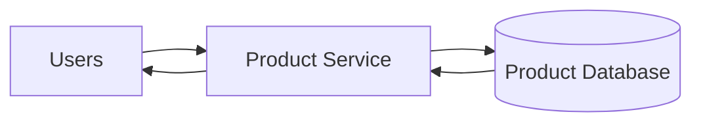

Nothing is technically broken.

The database is healthy. The Product Service is healthy. The network is healthy.

But we're asking the database essentially the same question tens of thousands of times.

---

### The Cost of Repeated Work

Suppose retrieving the product requires more than a simple primary-key lookup.

The application may need product information, pricing, availability, ratings, seller information, and other data before constructing the response.

Even if each operation is relatively fast, repeating it at large scale creates significant work.

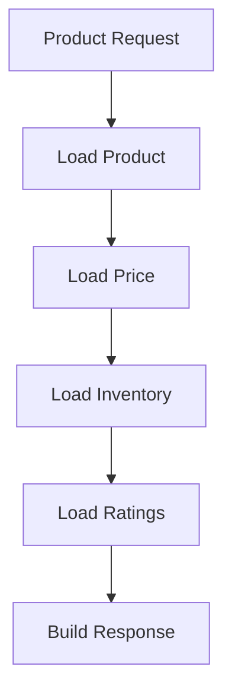

Now multiply that work by thousands of requests per second.

The problem isn't necessarily that one query is expensive. The problem is that we're repeatedly performing work whose result may already be known.

---

### Why Scaling the Database Isn't Always the Best First Answer

A natural response might be:

> "Why don't we just make the database bigger?"

Sometimes that's exactly what you should do.

You could add more CPU and memory, introduce read replicas, optimize indexes, partition data, or scale horizontally where the database technology allows it.

But before adding infrastructure, there's a simpler question worth asking:

**Does the database need to perform this work at all?**

If 10,000 users request the same product information and that information hasn't changed, repeatedly retrieving it from the primary data store may be unnecessary.

Instead, we could retrieve it once and temporarily keep the result somewhere faster.

---

### Introducing a Cache

A cache is a faster storage layer that keeps frequently accessed data closer to the application.

The architecture now looks something like this:

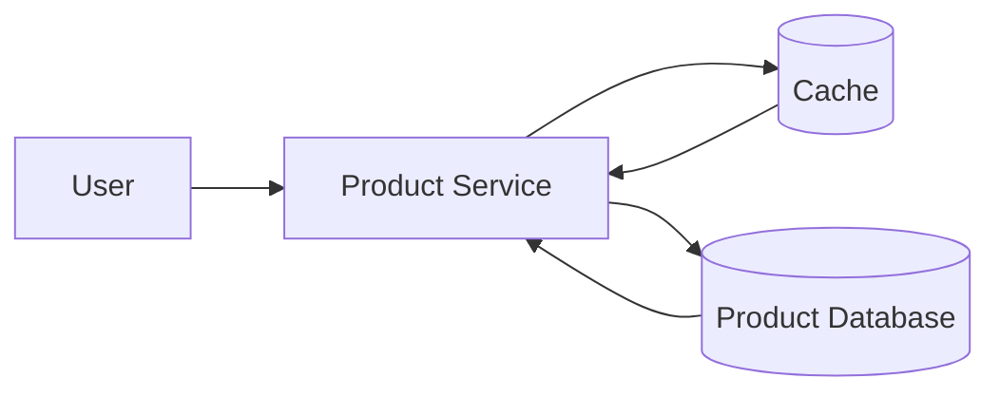

The database remains important. In most Cache-Aside architectures, it remains the authoritative source of truth.

The cache simply gives the application a faster path for data that has already been retrieved.

Technologies such as Redis are commonly used for this purpose, but the important concept isn't the technology. A cache can exist in memory, inside the application, in a distributed caching system, at a CDN, or at several layers simultaneously.

The important idea is **reusing previously computed or retrieved information instead of repeating expensive work**.

---

### Cache Hit: When the Answer Is Already Available

Suppose the product data already exists in the cache.

The request can be served without querying the database.

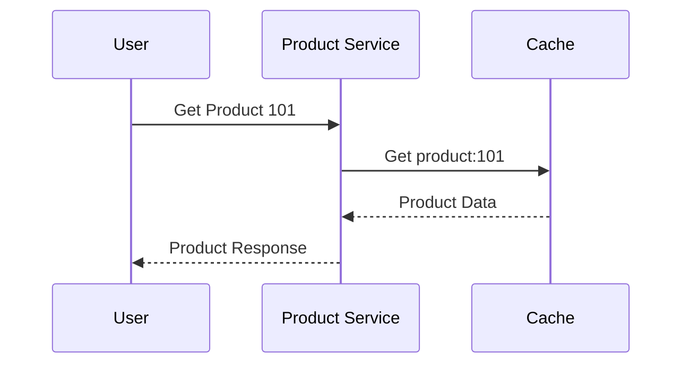

This is called a **cache hit**.

Cache hits are valuable because caches are generally designed to provide very fast access to frequently requested data.

More importantly, the database never sees this request.

If thousands of requests can be served this way, caching doesn't just improve latency. It also reduces pressure on downstream infrastructure.

---

### Cache Miss: When the Answer Isn't Available

Now suppose another customer requests Product 205, which isn't currently cached.

The application cannot return the data from the cache, so it falls back to the database.

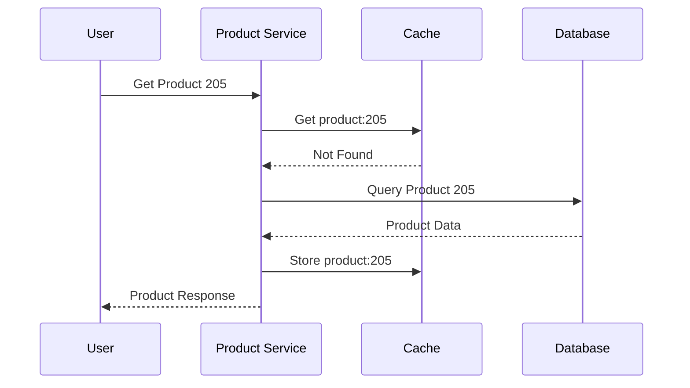

This is a **cache miss**.

Notice what the application did after retrieving the data from the database: it stored the result in the cache.

The next request for Product 205 may therefore avoid the database completely.

This read flow is the foundation of the Cache-Aside Pattern.

---

### Why Is It Called Cache-Aside?

The cache sits **beside** the primary database rather than replacing it.

The application is responsible for deciding which data source to use.

The basic read logic is:

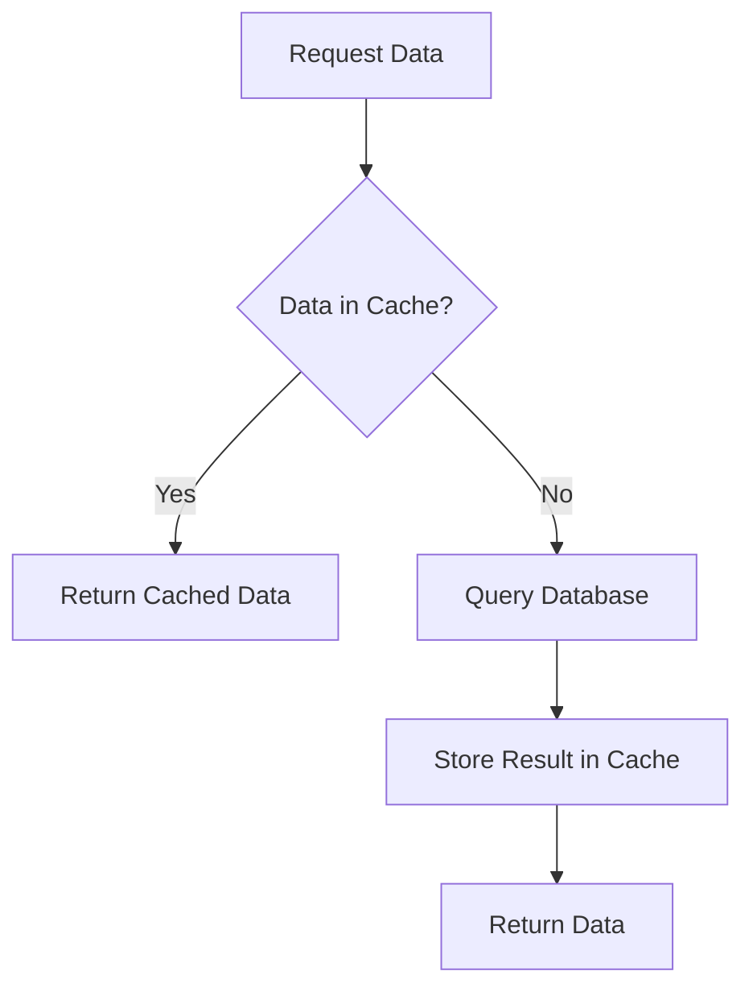

This distinction matters because there are other caching patterns where the cache itself is responsible for loading or writing data.

With Cache-Aside, **the application controls the caching behavior**.

That gives developers considerable flexibility, but it also gives them responsibility for keeping the cache and database reasonably consistent.

And that's where caching becomes much more interesting.

---

### The First Real Problem: Data Changes

Suppose Product 101 is cached with this price:

```text
₹999
```

A seller changes the price in the database:

```text
₹899
```

But the cache still contains:

```text
₹999
```

A customer opens the product page.

Which price do they see?

If the application reads from the cache, it may return the old value.

The cache has improved performance, but it has introduced something the database only architecture didn't have:

**stale data.**

---

### Why Cache Invalidation Is Hard

Reading cached data is relatively easy. Deciding when that data is no longer valid is much harder.

Suppose we update the database and then delete the cache entry.

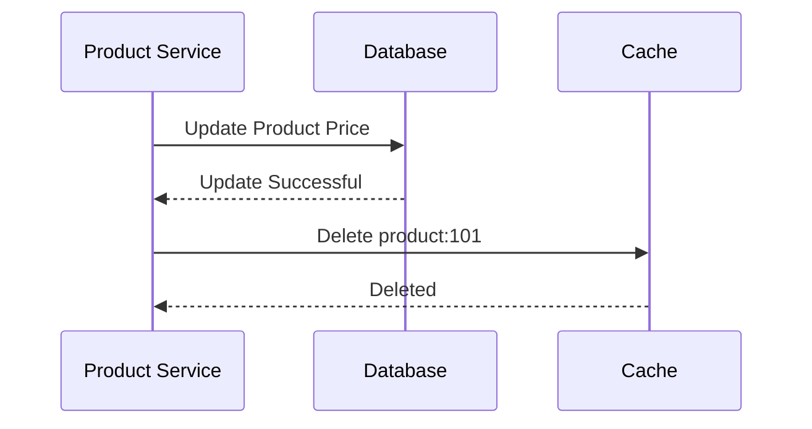

The next request produces a cache miss, retrieves the new value from the database, and repopulates the cache.

That sounds straightforward, but production systems introduce difficult questions.

What if cache deletion fails?

What if two requests update the same record simultaneously?

What if another request reads the old value between the database update and cache invalidation?

What if the cached data is spread across multiple regions?

Caching reduces one class of problems while introducing another: **consistency**.

---

### Design Challenge

Imagine you're caching product information for an e-commerce application.

The product description changes once every few months, inventory changes hundreds of times per minute, and the price may change several times per day.

Should all three fields use the same caching strategy?

Probably not.

A product description can tolerate being slightly stale. Inventory may require much stronger freshness guarantees because showing an unavailable product as "in stock" can create real business problems.

This is an important principle:

> Whether data should be cached depends not only on how often it is read, but also on how quickly it changes and how harmful stale data would be.

---

**TTL: Letting Cached Data Expire**

One common strategy is assigning cached values a **Time To Live (TTL)**.

For example:

```text
Product Description → 1 hour
Product Rating      → 5 minutes
Inventory           → 10 seconds
```

Once the TTL expires, the cache entry is removed or treated as expired. The next request retrieves fresh data from the database.

TTL provides a useful safety mechanism because even if explicit invalidation fails, stale entries don't necessarily survive forever.

However, shorter TTLs increase database traffic, while longer TTLs increase the chance of serving stale data.

Caching is therefore a trade-off between **freshness, latency, and backend load**.

---

**The Second Problem: The Cache Can Fail Too**

Adding a cache gives us another dependency.

Consider this architecture:

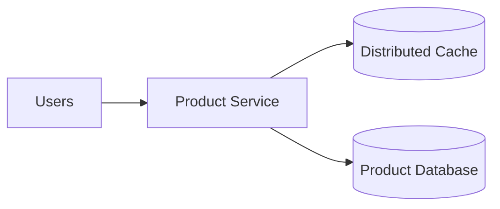

If the cache becomes unavailable and every request suddenly falls back to the database, the database may experience a massive traffic spike.

A cache failure can therefore become a database failure if the system isn't designed carefully.

This phenomenon becomes especially dangerous in large systems where the database normally sees only a small percentage of total read traffic.

The cache was introduced to protect the database.

Now the architecture must also consider how to protect the database **from the cache disappearing**.

---

### The Write Path: What Happens When Data Changes?

Consider our product example again.

Product `101` currently has this price:

```text
Database: ₹999
Cache:    ₹999
```

The seller changes the price to:

```text
₹899
```

Updating the database alone isn't enough because customers may continue receiving `₹999` from the cache.

One common Cache-Aside approach is:

1. Update the database.
2. Invalidate the corresponding cache entry.
3. Allow the next read to repopulate the cache.

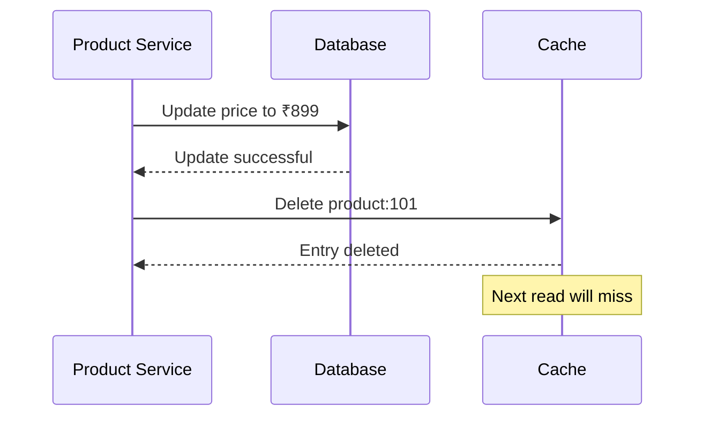

Notice that we're deleting the cached value rather than immediately replacing it.

The next read follows the normal Cache-Aside flow and retrieves the authoritative value from the database.

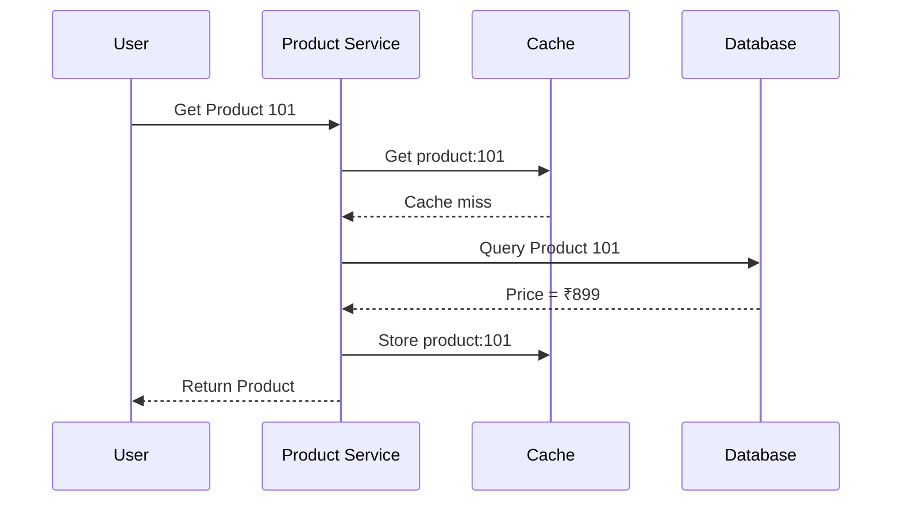

This keeps the read path simple and makes the database the source of truth.

But there's an important detail hidden inside this flow.

What happens if the database update succeeds and cache invalidation fails?

---

### When Cache Invalidation Fails

Suppose the database contains:

```text
₹899
```

while the cache still contains:

```text
₹999
```

The application now has two conflicting versions of the same information.

Requests hitting the cache may continue seeing the old price until the entry expires or another mechanism invalidates it.

This is one reason TTLs remain useful even when applications explicitly invalidate cache entries. A TTL acts as a safety net that limits how long stale data can survive.

It doesn't guarantee perfect consistency, but many systems don't actually require perfect consistency for every piece of data.

The important question is how much staleness the business can tolerate.

---

### Not All Data Deserves the Same TTL

Consider three pieces of product information.

| Data                | Change Frequency |                 Example TTL |
| ------------------- | ---------------: | --------------------------: |
| Product description |              Low |                      1 hour |
| Rating summary      |           Medium |                   5 minutes |
| Inventory           |             High | A few seconds or not cached |

These aren't universal recommendations. The appropriate values depend on the application.

The point is that **TTL should reflect the behavior and correctness requirements of the data**.

A stale product description is usually harmless. Stale inventory can result in customers purchasing something that no longer exists.

This is why setting something like:

```text
DEFAULT_CACHE_TTL = 3600
```

for every piece of application data is usually too simplistic.

---

### Cache Keys Matter More Than They Look

Suppose we store products using:

```text
product:101
product:102
product:103
```

That's straightforward.

Now imagine an API that supports currency, language, region, and user-specific pricing.

This request:

```text
/products/101?currency=USD&language=en
```

may not return the same response as:

```text
/products/101?currency=EUR&language=de
```

If both map to:

```text
product:101
```

the cache can return the wrong representation.

A better key might encode the dimensions that affect the response:

```text
product:101:en:USD
```

Cache keys should be deterministic, predictable, and specific enough to distinguish responses that are genuinely different.

Poor cache-key design can create correctness bugs that are difficult to reproduce because the database itself still contains perfectly valid data.

---

### The Cache Stampede Problem

Now consider a popular product being requested 20,000 times per second.

Its cache entry expires.

What happens next?

Thousands of requests may check the cache almost simultaneously.

They all receive:

```text
MISS
```

Then they all query the database.

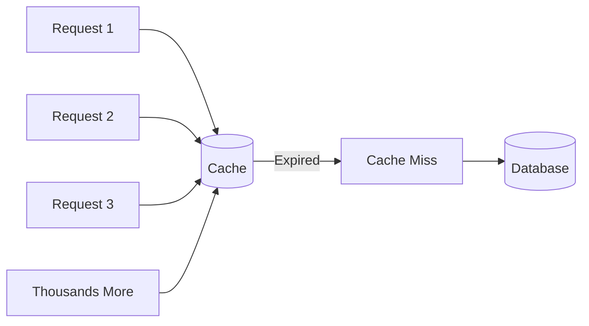

A cache designed to protect the database has suddenly directed a huge burst of traffic toward it.

This is known as a **cache stampede**.

The database may normally handle only a fraction of application traffic because the cache absorbs most reads. A sudden wave of cache misses can therefore overwhelm it very quickly.

---

### Preventing a Cache Stampede

One strategy is to allow only one request to rebuild an expired entry.

The first request obtains a short-lived lock and queries the database. Other requests either wait briefly, serve an older value when acceptable, or use another fallback strategy.

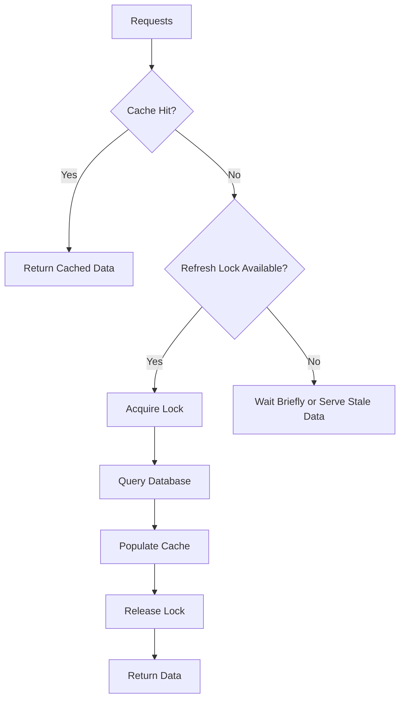

Another strategy is refreshing popular entries before they expire.

The correct approach depends on how expensive the underlying query is and how much stale data the application can tolerate.

---

### Cache Avalanche: When Many Keys Expire Together

A stampede usually involves heavy contention around one or a small number of popular keys.

A related problem occurs when **many cache entries expire around the same time**.

Imagine storing one million product entries at noon with exactly:

```text
TTL = 60 minutes
```

At approximately 1:00 PM, a huge number of those entries may expire together.

The database suddenly receives a large wave of requests.

One mitigation is adding a small random variation to expiration times.

Instead of every entry using exactly:

```text
3600 seconds
```

entries might expire around:

```text
3420 seconds
3710 seconds
3550 seconds
3840 seconds
```

The exact values aren't important. The goal is to avoid synchronized expiration.

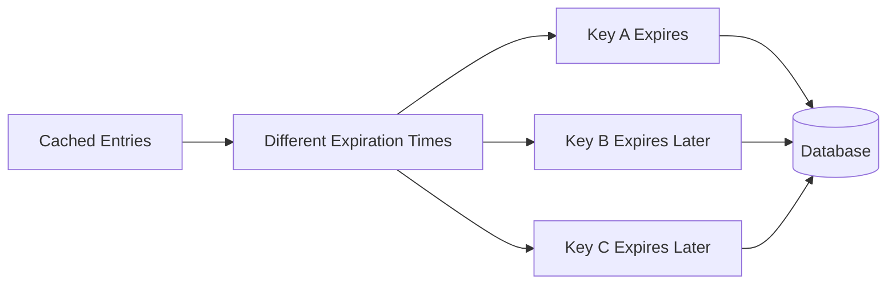

The database still receives refresh traffic, but that traffic is spread over time instead of arriving as one large spike.

---

### Cache Penetration: Requests for Data That Doesn't Exist

Suppose someone repeatedly requests:

```text
/product/999999999
```

but Product `999999999` doesn't exist.

The application checks the cache.

Miss.

It checks the database.

Not found.

The next request arrives.

Cache miss again.

Database query again.

If nonexistent values aren't cached, repeated requests for invalid identifiers can continuously bypass the cache.

This is often called **cache penetration**.

One simple mitigation is temporarily caching the negative result:

```text
product:999999999 → NOT_FOUND
TTL → 30 seconds
```

Now repeated requests can be rejected without repeatedly querying the database.

The TTL should usually remain relatively short because the resource might legitimately be created later.

---

### What Happens When the Cache Goes Down?

This is one of the most important production questions.

Imagine the normal traffic pattern is:

```text
100,000 requests/sec
        │
        ├── 95,000 served by cache
        │
        └── 5,000 reach database
```

The database has therefore been sized and tuned around roughly 5,000 reads per second.

Now Redis becomes unavailable.

Suddenly:

```text
100,000 requests/sec
        │
        ▼
     Database
```

The database doesn't necessarily have enough capacity for that transition.

A cache outage can therefore trigger a database outage.

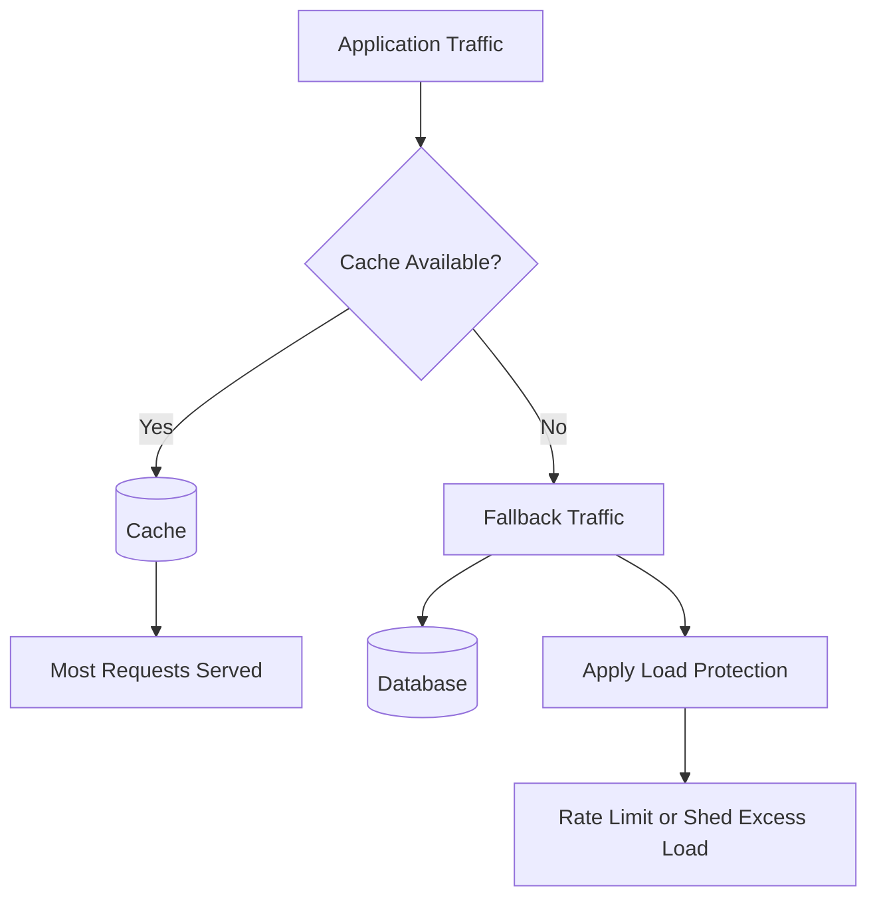

A resilient design needs to consider degraded operation before the cache fails, not after.

Depending on the system, protection might include rate limiting, request shedding, circuit breakers, database capacity headroom, or serving stale values.

The key principle is that **fallback capacity is still capacity**. Sending everything to the database isn't automatically a safe fallback.

---

### Eviction: What Happens When the Cache Is Full?

Caches have finite memory.

Eventually, the system has to decide which data should be removed.

This is called **eviction**.

Common policies include concepts such as:

- Least Recently Used (LRU)
- Least Frequently Used (LFU)
- TTL-based expiration

The appropriate strategy depends on the access pattern.

If a small number of products receive most traffic, frequency can be useful. If recently accessed data is likely to be accessed again soon, recency can be valuable.

The important lesson isn't memorizing eviction algorithms. It's recognizing that **cache capacity is finite**, which means the application needs a policy for deciding what deserves to remain close to the application.

---

### Cache Hit Ratio

One of the most useful caching metrics is the **cache hit ratio**.

Suppose the system receives:

```text
1,000,000 cache lookups

950,000 hits
50,000 misses
```

The hit ratio is:

```text
95%
```

A high hit ratio often means the cache is successfully absorbing database traffic.

But the number shouldn't be interpreted in isolation.

A 99% hit ratio may still be poor if the remaining 1% represents extremely expensive database queries. A lower hit ratio may be completely acceptable if misses are inexpensive.

Useful cache monitoring usually includes:

- Hit and miss rate
- Cache latency
- Memory utilization
- Eviction rate
- Expiration rate
- Database traffic caused by misses
- Error rate
- Hot-key distribution

The goal isn't simply to achieve the highest possible hit ratio. The goal is to reduce latency and backend load without creating unacceptable consistency problems.

---

### What Should Actually Be Cached?

Caching works particularly well for data that is:

- Read frequently
- Expensive to retrieve or compute
- Relatively stable
- Safe to serve slightly stale
- Shared across many requests

Examples might include:

```text
Product details
Configuration
Feature metadata
Search suggestions
Popular content
Aggregated statistics
```

Data that changes constantly or requires strong consistency deserves more careful consideration.

Examples might include:

```text
Account balances
Real-time inventory
Security permissions
Critical transaction state
```

That doesn't mean these values can never be cached. It means the consistency strategy becomes much more important.

---

### When Cache-Aside Is the Wrong Choice

Cache-Aside is popular because it's simple and gives the application direct control over caching.

That control also creates complexity.

The application needs logic for:

- Cache misses
- Cache population
- Invalidation
- TTLs
- Failure handling

For some systems, other caching patterns may be a better fit.

For example:

**Read-Through caching** allows the cache layer to retrieve missing data automatically.

**Write-Through caching** updates the cache as part of the write path.

**Write-Behind caching** accepts writes into the cache and persists them asynchronously.

These patterns make different trade-offs around performance, complexity, and consistency.

We'll explore those patterns separately rather than treating "caching" as one generic technique.

---

### Putting the Complete Cache-Aside Flow Together

Our simple architecture has now become more realistic.

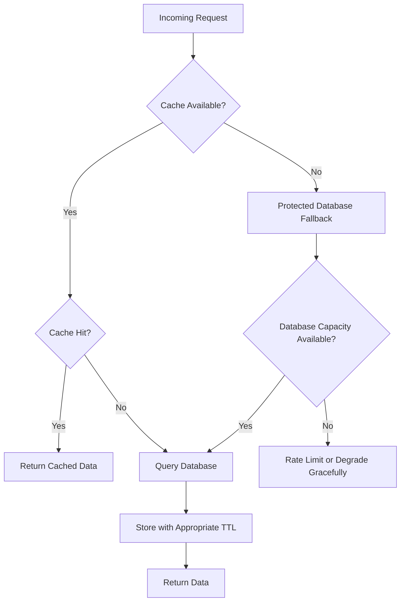

This diagram captures something important.

Caching is not just:

```text
Application → Redis → Database
```

A real caching strategy needs behavior for hits, misses, expiration, cache failure, database protection, and stale data.

The technology is usually the easy part.

The policy is where most of the engineering lives.

---

### Key Takeaways

The Cache-Aside Pattern can dramatically reduce database load and improve latency, but it introduces a second copy of data that the application must manage carefully.

A good Cache-Aside design considers more than where the Redis server lives. It defines what should be cached, how keys are structured, how long entries remain valid, how updates invalidate stale values, what happens during cache misses, and how the database is protected if the cache becomes unavailable.

Three production problems are especially worth remembering:

- **Cache stampede:** many requests miss the same popular key simultaneously.
- **Cache avalanche:** many cached entries expire around the same time.
- **Cache penetration:** repeated requests for nonexistent data bypass the cache.

Caching works best when the system deliberately accepts a certain amount of staleness in exchange for lower latency and reduced backend load. The right balance depends on the business meaning of the data.

The most important question isn't:

> "Should we use Redis?"

It's:

> "Which work are we repeatedly doing that we don't actually need to repeat?"

Once you can answer that, the caching technology becomes a much easier decision.

---

### In the Next Blog

Cache-Aside gives the application complete control over the cache, but that also means every service needs to implement the same basic logic: check the cache, handle misses, query the database, populate the cache, and deal with failures.

What if the application didn't need to manage that read logic itself?

In the next article, we'll explore the **Read-Through Cache Pattern**, where the cache becomes responsible for retrieving missing data from the underlying data store.

We'll compare it directly with Cache-Aside and understand why two architectures that look almost identical can create very different responsibilities inside a production system.
