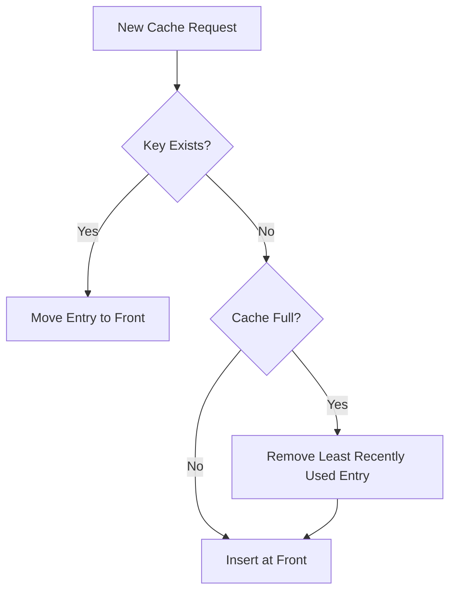

## Cache Eviction Policies: What Happens When Your Cache Runs Out of Memory?

In the previous blogs, we explored Cache-Aside, Read-Through, Write-Through, and Write-Behind caching. Each pattern addressed a different problem: reducing database reads, simplifying cache access, keeping cached data updated, and improving write throughput.

But all these approaches share one assumption: **there is enough memory to store the data we want to cache.**

In production, that assumption eventually breaks.

Imagine an e-commerce application caching product details, user sessions, shopping carts, search results, and frequently accessed categories.

Initially, the cache performs well. As traffic grows, more keys are added. Some keys are accessed thousands of times, while others are accessed once and never requested again.

Eventually, the cache reaches its memory limit.

What should happen next?

We cannot simply keep adding data indefinitely. Increasing memory is possible, but it has a cost and does not eliminate the underlying problem.

The cache needs a strategy to decide which existing entries should be removed to make room for new ones.

This is where **cache eviction policies** become important.

### What Is Cache Eviction?

Cache eviction is the process of removing existing entries from a cache when it needs to free memory or enforce a memory limit.

The objective is not simply to remove old data. It is to remove data that is less valuable to keep, while preserving entries that are likely to be requested again.

Consider a cache with space for only five products:

| Product | Access Count | Last Access |
|---|---:|---|
| Product A | 120 | 2 minutes ago |
| Product B | 3 | 1 day ago |
| Product C | 85 | 5 minutes ago |
| Product D | 1 | 3 hours ago |
| Product E | 40 | 10 minutes ago |

A new product arrives, but the cache is full.

Which product should be removed?

Product B has been accessed only three times. Product D has been accessed once. Product A has been accessed 120 times and is still being requested.

Removing Product A would probably be a poor decision.

However, access count is not the only way to determine whether an entry is valuable. Recent activity, expiration time, size, and workload patterns can all influence the decision.

Different eviction policies use different signals to make this decision.

### Least Recently Used (LRU)

LRU removes the entry that has not been accessed for the longest time.

The assumption is straightforward:

**If a key has not been used recently, it is less likely to be needed in the near future.**

Suppose our cache contains:

```text
A → Last accessed 10:00
B → Last accessed 10:05
C → Last accessed 10:10
D → Last accessed 10:15
```

A new entry arrives.

The cache removes A because it was accessed least recently.

### How LRU works

A typical LRU implementation maintains two data structures:

- A hash map for accessing entries in O(1) average time.
- A doubly linked list for tracking access order.

The most recently accessed entry moves to the front. The least recently accessed entry stays at the tail.

When the cache needs to evict an entry, it removes the tail.



**Example**

Assume the cache can hold three entries.

```text
Initial cache:
A → B → C

Access A:
A → B → C

Access C:
C → A → B

Insert D:
D → C → A

B is evicted.
```

The ordering represents most recently used to least recently used.

### Where LRU works well

LRU is useful when recent access is a good indicator of future access.

Examples include:

- Recently viewed product details.
- Frequently revisited application pages.
- User profile information.
- Recently accessed configuration data.

### Where LRU fails

Consider a workload where an application periodically scans millions of records.

The scan may access many entries once, pushing genuinely popular entries out of the cache.

This is known as a scan-pollution problem.

LRU can also struggle when the working set is slightly larger than the available cache capacity. Frequently accessed entries may repeatedly get displaced by newer entries.

LRU is a strong baseline, but it is not universally optimal.

### Least Frequently Used (LFU)

LRU considers when an entry was last accessed.

LFU considers how often an entry has been accessed.

The assumption is:

**Entries requested frequently are more valuable than entries requested rarely.**

Imagine the following cache:

| Key | Access Count |
|---|---:|
| A | 150 |
| B | 90 |
| C | 12 |
| D | 4 |

If the cache needs to remove an entry, LFU selects D.

### How LFU works

A basic LFU implementation maintains:

- A hash map containing cache entries and their access frequencies.
- Frequency buckets containing entries with the same frequency.
- A minimum frequency tracker to identify the least frequently used bucket.

When an entry is accessed, its frequency increases.

When eviction is required, an entry from the minimum-frequency bucket is removed.

If multiple entries have the same frequency, an implementation may use LRU as a tie-breaker.

### The problem with basic LFU

Consider an application that experienced a traffic spike last week.

A particular product received 100,000 requests during that period. Its frequency count is now extremely high.

But today, nobody is requesting it.

Meanwhile, another product has started receiving significant traffic.

Basic LFU may continue protecting the old popular product because its historical frequency is still high.

This is the **stale frequency problem**.

A common solution is frequency aging: gradually reduce frequency counts over time so that recent popularity can influence eviction decisions.

### Where LFU works well

- Stable, long-term popularity patterns.
- Frequently requested reference data.
- Popular product catalogs.
- Frequently accessed application configuration.

LFU is less attractive when popularity changes rapidly unless the implementation accounts for changing access patterns.

### First In, First Out (FIFO)

FIFO removes the entry that entered the cache first.

Unlike LRU and LFU, FIFO does not consider how frequently or recently an entry was accessed.

Suppose entries arrive in this order:

```text
A → B → C → D
```

The cache is full and a new entry E arrives.

FIFO removes A because it was inserted first.

Even if A was accessed one second ago, it can still be evicted.

**Advantages**

- Simple to implement.
- Low metadata overhead.
- Predictable eviction order.

**Disadvantages**

- Ignores access frequency.
- Ignores recent usage.
- Can remove frequently requested entries.

FIFO is useful when insertion order is a reasonable approximation of usefulness, but it is generally less effective for workloads with unpredictable access patterns.

### Time To Live (TTL)

TTL is slightly different from the policies discussed above.

LRU, LFU, and FIFO decide which entries to remove when memory needs to be reclaimed.

TTL defines how long an entry is allowed to remain valid.

For example:

```text
product:101 → TTL: 300 seconds
user:501    → TTL: 1800 seconds
session:901 → TTL: 3600 seconds
```

After the configured lifetime expires, the entry is considered expired.

TTL is particularly useful when cached data naturally becomes stale.

Examples:

- Product prices.
- Search results.
- Weather information.
- Temporary authentication sessions.
- Frequently changing inventory information.

### TTL does not always mean immediate deletion

An important distinction is that expiration and physical memory reclamation are not necessarily the same event.

Depending on the cache implementation, expired entries may be removed:

- When a client accesses the expired key.
- Through periodic background expiration checks.
- Through a combination of both.

For example, Redis uses passive expiration when an expired key is accessed and active expiration through periodic sampling.

### Why TTL is not a complete eviction strategy

Imagine a cache with a 30-minute TTL.

A popular product and an unused product both receive the same expiration period.

The popular product may still be useful after 30 minutes, while the unused product may never be requested again.

TTL alone does not make decisions based on memory pressure or access popularity.

It is often combined with an eviction policy.

### Random Replacement (Random Eviction)

Random replacement removes an arbitrary entry when space is needed.

It does not track access order or frequency.

For example:

```text
Cache:
A, B, C, D, E

New entry arrives.

Randomly selected entry:
C

Result:
A, B, D, E, New
```

Its main advantage is simplicity. It avoids maintaining complex access metadata.

However, it can remove a highly valuable entry just as easily as an unused one.

Random replacement is not usually the first choice when access patterns are highly skewed, but it can be useful when metadata overhead matters or when the workload makes sophisticated tracking less valuable.

### Comparing Eviction Policies

| Policy | Eviction Criteria | Main Advantage | Main Limitation |
|---|---|---|---|
| LRU | Least recently accessed | Adapts to recent usage | Scan pollution |
| LFU | Least frequently accessed | Preserves popular entries | Historical frequency can become stale |
| FIFO | Oldest inserted | Simple and predictable | Ignores access patterns |
| TTL | Expired lifetime | Controls data freshness | Does not prioritize popularity |
| Random | Arbitrary entry | Minimal tracking overhead | Can remove valuable entries |

There is no universally best eviction policy.

The right choice depends on how the application accesses its data.

### What Does Redis Do?

So far, we have discussed eviction algorithms conceptually. In production, the cache implementation matters just as much as the algorithm.

Redis provides configurable eviction policies through its `maxmemory-policy` setting.

When Redis reaches its configured memory limit, the selected policy determines what happens when additional memory is required.

Some important policies include:

| Redis Policy | Behaviour |
|---|---|
| `noeviction` | Does not evict keys; memory-requiring writes can fail |
| `allkeys-lru` | Evicts least recently used keys from all keys |
| `allkeys-lfu` | Evicts least frequently used keys from all keys |
| `allkeys-random` | Evicts random keys from all keys |
| `volatile-lru` | Evicts least recently used keys with an expiration set |
| `volatile-lfu` | Evicts least frequently used keys with an expiration set |
| `volatile-random` | Evicts random keys with an expiration set |
| `volatile-ttl` | Evicts keys with the shortest remaining TTL among keys with an expiration set |

The distinction between `allkeys-*` and `volatile-*` is important.

- `allkeys-*` policies consider all keys.
- `volatile-*` policies consider only keys that have an expiration set.

If no eligible keys exist under a volatile policy, Redis cannot evict an entry using that policy. A memory-requiring write may therefore fail.

**Example Redis configuration**

```conf
maxmemory 2gb
maxmemory-policy allkeys-lru
```

This configuration limits Redis to a configured memory budget of 2 GB and uses LRU-based eviction across all keys.

Another possible configuration:

```conf
maxmemory 2gb
maxmemory-policy allkeys-lfu
```

This uses LFU-based eviction across all keys.

The correct choice should be based on observed workload behaviour, not simply because one algorithm sounds more sophisticated.

### A production detail: Redis LRU and LFU are approximations

Redis does not maintain a perfectly ordered global list of all keys for its eviction algorithms.

It uses sampled candidate selection to keep the overhead of tracking and eviction manageable.

This matters because eviction is itself part of the cache's performance budget. A theoretically perfect policy is not necessarily worth its operational cost.

**Choosing the Right Eviction Policy**

Let's return to our e-commerce application.

Different types of cached data can have different access patterns.

| Data | Likely Access Pattern | Possible Strategy |
|---|---|---|
| Popular product details | Repeated access | LRU or LFU |
| Product search results | Frequently changing | TTL combined with LRU |
| User sessions | Time-bounded validity | TTL |
| Product categories | Stable, repeated access | LRU or LFU |
| Temporary API responses | Short-lived | TTL |
| One-time generated data | Unpredictable access | Workload-dependent |

These are starting points, not universal rules.

For example, a popular product catalog might benefit from LFU when popularity is stable. If product popularity changes rapidly, LRU or an LFU policy with frequency aging may perform better.

The important thing is to understand the workload before choosing the policy.

**What Happens When the Wrong Data Gets Evicted?**

Eviction is not free.

When a frequently requested entry is removed, the next request becomes a cache miss.

The application may need to fetch that data from the database or another upstream service.

Consider a product page receiving 10,000 requests per minute.

Suppose its product details are cached and every request normally takes the cache-hit path.

If the entry gets evicted, the next request triggers a database lookup and potentially a cache refill.

Now imagine this happening to hundreds of popular keys.

The database receives a sudden increase in traffic.

If the database cannot handle the additional load, request latency increases. Timeouts and retries may follow, potentially creating even more load.

This means eviction policy is not merely a memory-management decision. It can affect the reliability of the entire application.

**Monitor the consequences, not just memory usage**

Some useful metrics include:

- Cache hit ratio.
- Cache miss rate.
- Evicted keys per second.
- Cache memory usage.
- Database query rate.
- Cache read latency.
- Cache write latency.
- Key expiration rate.

A high eviction rate is not automatically bad. A cache that is constantly replacing old entries may be operating correctly for its workload.

However, a high eviction rate combined with a falling hit ratio and increasing database traffic is a strong signal that the cache may be undersized or using an unsuitable policy.

### A Practical Production Scenario

Imagine an application with:

- 2 GB of cache memory.
- 10 million product records.
- A small group of highly popular products.
- A long tail of rarely requested products.

The team initially uses LRU.

After observing production traffic, they notice:

1. Product popularity is relatively stable.
2. A small percentage of products account for most requests.
3. Bulk catalog scans occasionally push popular entries out.
4. Database reads increase during those scans.

The team evaluates LFU with frequency aging and compares its hit ratio and eviction behaviour against LRU.

They also consider whether bulk jobs should bypass the cache or use a separate cache namespace.

The final decision should be based on measured performance under representative traffic.

This is an important point: **choosing an eviction algorithm is not a substitute for designing the workload around the cache.**

Sometimes the best improvement is not changing LRU to LFU. It is preventing a background process from polluting the cache in the first place.

### Design Challenge

You are designing a caching layer for an e-commerce application.

The cache stores:

- Product details.
- User sessions.
- Search results.
- Shopping cart data.
- Frequently accessed category information.

The cache has a fixed memory budget.

Your task is to decide:

1. Which data should have a TTL?
2. Which data should be protected from eviction, if any?
3. Would LRU or LFU be more suitable for product details?
4. How would you prevent bulk catalog scans from polluting the cache?
5. What would you monitor to determine whether the eviction policy is working?

There is no single correct answer. Your decisions should reflect the access patterns, freshness requirements, and consequences of a cache miss.

### Final Thoughts

A cache is not designed to store everything. It is designed to keep the most useful data readily available within a limited memory budget.

LRU prioritizes recent access. LFU prioritizes repeated access. FIFO prioritizes insertion order. TTL controls how long data remains valid. Random replacement trades intelligence for simplicity.

Each policy makes a different assumption about what makes data valuable.

The challenge is to choose an assumption that matches the behaviour of your application, then validate it with production metrics.

In the next blog, we'll look at another caching challenge: **Refresh-Ahead Caching** - instead of waiting for an entry to expire and making the next request pay the cost of fetching it again, can we refresh data before it becomes stale?
