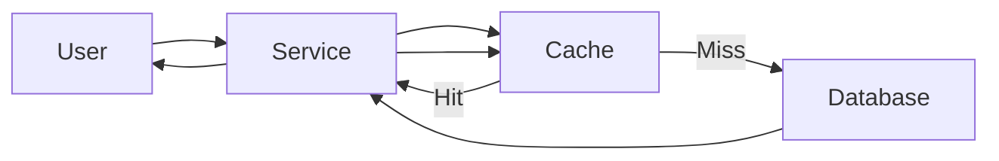
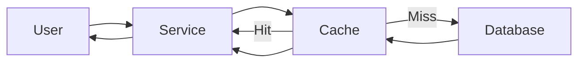
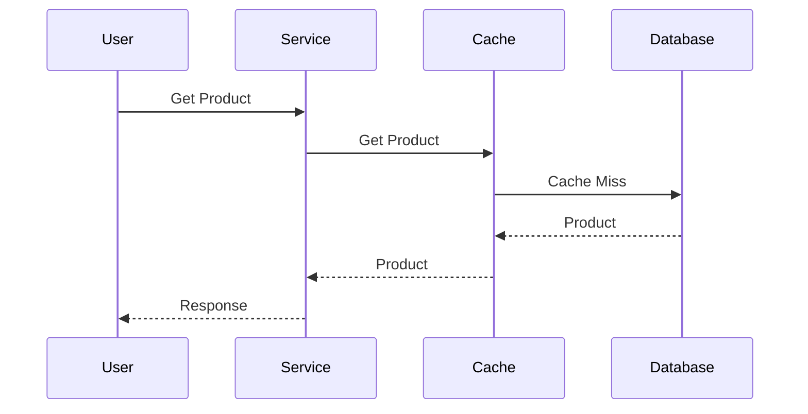
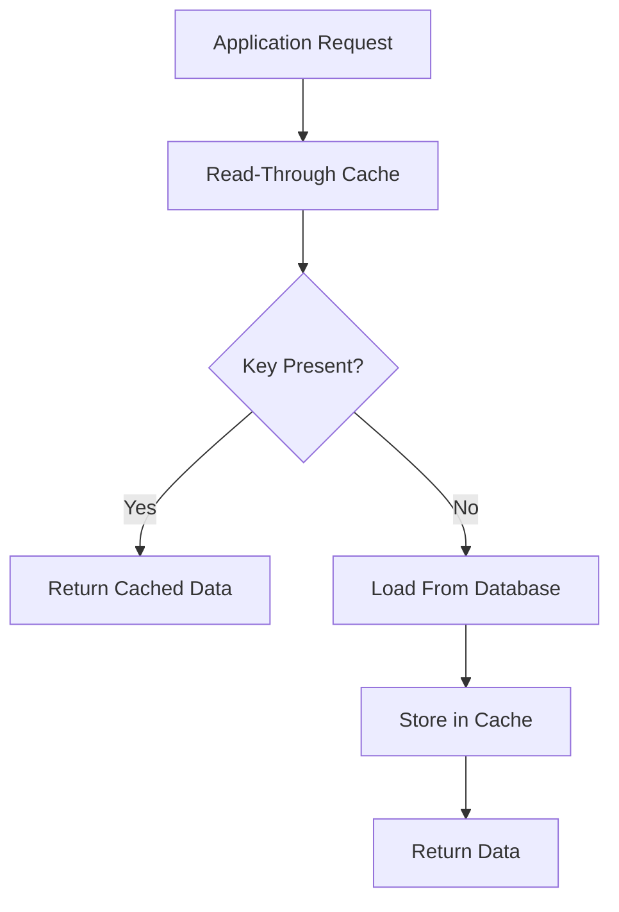
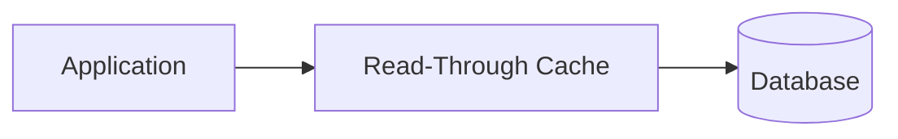
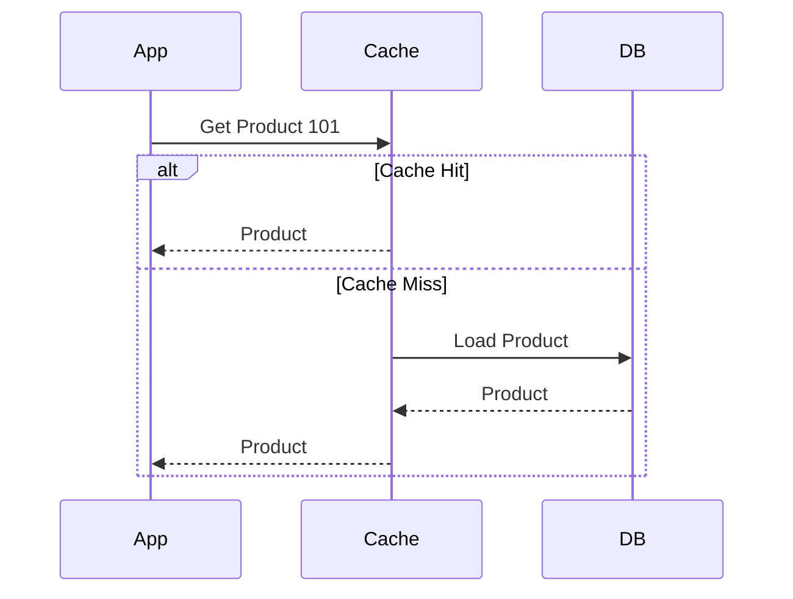
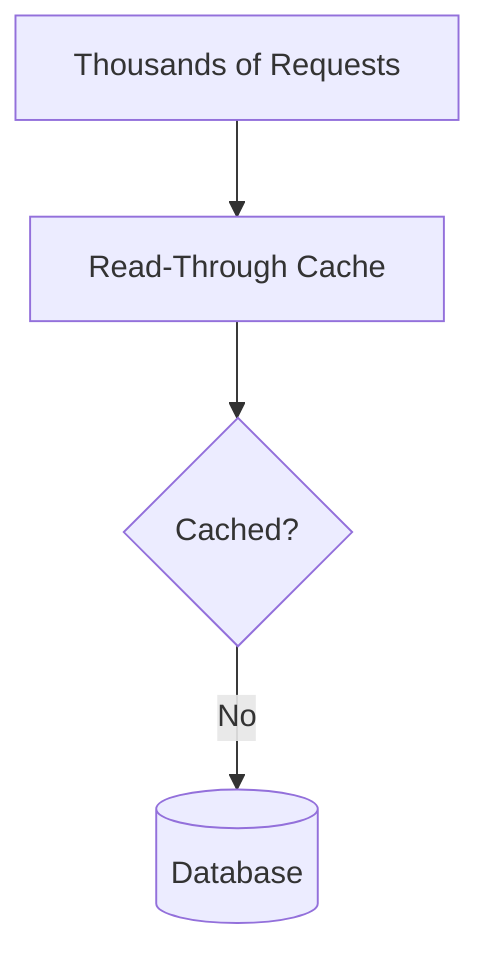

## Read-Through Cache: Why Should Your Application Know How to Fetch Missing Data?

**Previously...**

In the previous article, we introduced the Cache-Aside Pattern and learned how it reduces database load by storing frequently requested data in a cache.

The flow was straightforward.

The application first checked the cache. If the requested data was present, it returned the cached value. If not, it queried the database, stored the result in the cache, and finally returned the response to the user.

This approach works extremely well and is one of the most widely used caching strategies in production systems.

However, after implementing Cache-Aside across multiple services, another problem begins to emerge.

Not a performance problem.

A software engineering problem.

Every service ends up containing almost identical caching logic.

The Product Service has it.

The User Service has it.

The Order Service has it.

The Recommendation Service has it.

The database is no longer the source of duplicated work.

**The caching code is.**

---

### What You'll Learn

By the end of this blog, you'll understand:

- Why Cache-Aside introduces duplicated application logic.
- How the Read-Through pattern changes cache ownership.
- The responsibilities of the cache layer.
- How cache misses are handled automatically.
- The advantages and trade-offs compared to Cache-Aside.
- When Read-Through is the better choice and when it isn't.

---

### A Production Story

Imagine you're working on a growing e-commerce platform.

At first, only the Product Service required caching.

Implementing Cache-Aside was simple.

```java
product = cache.get(id);

if(product == null){
    product = database.get(id);
    cache.put(id, product);
}

return product;
```

A few months later, the User Service also needed caching.

The implementation looked almost identical.

Soon after, the Order Service introduced caching.

Then Inventory.

Then Pricing.

Then Reviews.

One by one, every team copied essentially the same logic into their services.

The application wasn't becoming slower.

It was becoming repetitive.

---

### The Hidden Cost of Cache-Aside

Cache-Aside gives applications complete control over caching.

That flexibility is one of its biggest strengths.

It also means every service must answer the same questions repeatedly.

- Did the cache contain the data?
- If not, should we query the database?
- How should the cache key be constructed?
- What TTL should be used?
- Should the value be cached if the database returns nothing?
- What happens if writing to the cache fails?

None of these questions are unique to the Product Service.

Every service ends up implementing the same decision-making process.

Eventually, engineers begin asking an important question.

**Why is every application responsible for teaching the cache how to behave?**

---

### The Architecture Today

With Cache-Aside, the application controls every read.



Notice where the intelligence lives.

The cache only stores values.

The application decides:

- when to read,
- when to query the database,
- when to populate the cache,
- when to invalidate entries.

The cache is simply passive storage.

---

### Could the Cache Do More?

Imagine asking a different question.

Instead of teaching every service how to load missing data...

What if the cache already knew?

The application would only need to say:

> "Give me Product 101."

Whether that data came from memory or from the database would no longer be the application's responsibility.

The cache itself could decide.

This small shift changes the architecture considerably.

---

### Introducing Read-Through Cache

With Read-Through, the application no longer communicates directly with the database during read operations.

Instead, it communicates only with the cache.

If the requested value already exists, the cache immediately returns it.

If the value is missing, the cache loads it from the database automatically, stores it, and then returns the result to the application.

From the application's perspective, nothing changes.

It simply requests data.

The cache decides how to obtain it.

---

### The New Architecture



Notice the difference from Cache-Aside.

The application never communicates with the database directly during reads.

The cache has become an active participant instead of passive storage.

---

### Cache Misses Become Simpler

Let's look at the sequence of events.



The service never worries about handling the miss.

That responsibility has moved into the cache layer.

This is the defining characteristic of Read-Through.

---

### Why Teams Like This Pattern

As organizations grow, dozens of services may need caching.

Keeping cache population logic inside every service means:

- duplicated code,
- duplicated testing,
- duplicated bug fixes,
- duplicated monitoring.

Moving cache loading into a centralized layer creates consistency.

Every service follows the same caching rules without implementing them individually.

If the cache loading strategy changes, teams update one component instead of dozens.

---

### Design Challenge

Suppose you're responsible for fifty microservices.

Each service implements Cache-Aside.

One day the organization decides:

- cache empty responses,
- change TTL strategy,
- introduce compression,
- modify cache keys,
- add encryption.

Would you rather update fifty independent services...

or one centralized caching layer?

This is the problem Read-Through was designed to solve.

---

### A Trade-off Appears

Notice that we've solved one problem.

But we've introduced another.

The cache is no longer simple storage.

It now understands:

- how to reach the database,
- how to retrieve objects,
- how to populate entries,
- when data should be stored.

The cache has become significantly smarter.

Whenever one component becomes smarter...

it also becomes more complex.

Is that a worthwhile trade-off?

That depends on the architecture.

---

### A Complete Read Flow

With Read-Through, every request follows the same path.



Notice something important.

The application never checks whether the value exists.

It simply asks for the data.

The cache decides everything else.

This keeps application services focused on business logic rather than cache management.

---

### Cleaner Application Code

Compare the two approaches.

**Cache-Aside**

```java
Product product = cache.get(id);

if(product == null){
    product = database.get(id);
    cache.put(id, product);
}

return product;
```

**Read-Through**

```java
Product product = cache.get(id);

return product;
```

The missing logic hasn't disappeared.

It has simply moved into another layer.

That distinction matters because moving complexity isn't the same as removing complexity.

---

### Why Large Organizations Prefer Read-Through

Imagine an organization with sixty microservices.

Each service needs caching.

If every team implements Cache-Aside independently, differences begin appearing over time.

One service caches null responses.

Another doesn't.

One uses a 5-minute TTL.

Another uses 30 minutes.

One compresses values.

Another stores raw JSON.

Eventually, the organization has dozens of slightly different caching implementations.

Read-Through avoids this by centralizing cache-loading behavior.

Instead of every engineering team making caching decisions independently, those decisions are implemented once.

---

### Cache Becomes a Platform

The cache is no longer just infrastructure.

It becomes a shared platform.

That platform can enforce organization-wide standards such as:

- TTL policies
- Compression
- Serialization
- Cache-key conventions
- Metrics
- Retry strategy
- Logging
- Monitoring

Instead of asking every team to remember these concerns, they're handled automatically whenever data is loaded.

---

### The New Dependency

Centralization has advantages.

It also introduces a new dependency.

Previously, services understood how to retrieve data directly from the database.

Now they rely entirely on the cache.



If the cache platform cannot retrieve data correctly, every service depending on it is affected.

Instead of duplicated logic across many services, you've concentrated responsibility into one component.

This isn't necessarily bad.

It simply means the cache platform must now be engineered with the same care as any other production service.

---

### Cache Misses Still Exist

Read-Through doesn't eliminate cache misses.

It hides them.

When a requested key isn't present, the cache still performs the database lookup.

The application just doesn't see it.



The performance characteristics remain almost identical to Cache-Aside.

The ownership changes.

---

### What About Writes?

One common misconception is that Read-Through automatically handles writes.

It doesn't.

Read-Through is a **read pattern**.

The application still needs a strategy for updates.

A common flow looks like this:

1. Update the database.
2. Invalidate the cached entry.
3. Allow the next read to reload it.

Exactly like Cache-Aside.

This means cache invalidation remains one of the hardest problems in distributed systems regardless of which read pattern you choose.

---

### Cache Stampedes Can Still Happen

Suppose a popular key expires.

Ten thousand requests arrive simultaneously.

Every request asks the cache.

The cache discovers the key is missing.

Without protection, all of those requests may still query the database.

The fact that loading happens inside the cache doesn't eliminate the problem.



Production Read-Through systems often combine request coalescing or distributed locking so that only one request reloads the missing value while others wait briefly.

---

### Production Considerations

Before adopting Read-Through, architects usually ask several questions.

Can the cache directly communicate with the database?

How will authentication be handled?

Who owns schema evolution?

Can the cache understand every object type?

How will failures be monitored?

These questions don't exist because Read-Through is a poor pattern.

They exist because the cache has become part of the application's data access layer.

---

### Cache-Aside vs Read-Through

| Aspect | Cache-Aside | Read-Through |
|---------|-------------|--------------|
| Cache Miss Handling | Application | Cache |
| Database Access | Application | Cache |
| Application Complexity | Higher | Lower |
| Cache Complexity | Lower | Higher |
| Flexibility | High | Moderate |
| Centralized Policy | Difficult | Easy |

Neither approach is universally better.

They optimize different things.

Cache-Aside optimizes flexibility.

Read-Through optimizes consistency across services.

---

### When Should You Choose Read-Through?

Read-Through is often a strong choice when:

- Many services require identical caching behavior.
- A centralized platform team manages infrastructure.
- Consistent TTL and serialization policies are important.
- Applications should remain focused on business logic.

Cache-Aside often remains preferable when:

- Services require different caching strategies.
- Teams need full control over cache population.
- Business rules determine what should or shouldn't be cached.
- Infrastructure shouldn't understand domain objects.

---

### Key Takeaways

Read-Through doesn't make caching faster.

It makes caching **simpler for application developers** by moving cache population into the caching layer.

That simplicity comes with a trade-off. The cache becomes a much more intelligent component, responsible not only for storing data but also for retrieving it, applying policies, and serving as part of the application's data access path.

Like Cache-Aside, Read-Through still needs thoughtful invalidation strategies, sensible TTLs, protection against cache stampedes, and resilience when the cache itself experiences problems.

Choosing between Cache-Aside and Read-Through isn't about selecting the "better" pattern. It's about deciding **where the complexity should live**.

---

### Next Chapter

So far, both Cache-Aside and Read-Through have focused on optimizing **reads**.

But what happens when every write also needs to update the cache?

Should the application write to both the database and the cache?

Or should the cache itself handle writes?

In the next chapter, we'll explore the **Write-Through Cache Pattern** and see how it keeps cached data synchronized during write operations while simplifying consistency for read-heavy systems.
