## Write-Behind (Write-Back) Cache: What If the Database Doesn't Need to Know Immediately?

**Previously...**

In the previous article, we looked at Write-Through caching.

The idea was straightforward: the application writes to the cache, and the cache synchronously persists that change to the database before considering the operation successful.

That gives us an attractive property. Once a write succeeds, the cache contains the latest value and the database has also persisted it.

But there is a cost.

Every write still depends on the database.

For a read-heavy application, that may be perfectly acceptable. But consider a system receiving hundreds of thousands or millions of writes per second. If every write has to travel through the cache and wait for the database, the database remains part of the critical path.

That raises an interesting question:

> **What if the application didn't have to wait for the database at all?**

What if the cache could accept the write immediately and tell the application:

> "I've got it. I'll persist it later."

That's the fundamental idea behind **Write-Behind**, also called **Write-Back caching**.

---

### What You'll Learn

By the end of this article, you'll understand:

- Why Write-Through can become a bottleneck for write-heavy workloads.
- How Write-Behind moves database persistence out of the critical path.
- Why asynchronous persistence can dramatically improve write throughput.
- How batching multiple writes can reduce database pressure.
- What happens when the cache fails before data reaches the database.
- Why durability becomes the biggest concern.
- How Write-Behind compares with Write-Through.
- When the performance benefits justify the consistency and durability trade-offs.

---

### The Problem With Synchronous Writes

Imagine a system that records user activity.

Every action generates an event:

```text
User viewed product
User added item to cart
User opened notification
User searched for laptop
User watched video
```

Now imagine millions of users generating these events simultaneously.

With a Write-Through architecture, every write eventually needs to reach the database before the application can consider the operation complete.

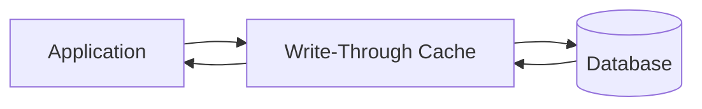

The cache may be extremely fast.

The database might not be.

If the database can process 50,000 writes per second but the application produces 200,000 writes per second, something has to absorb the difference.

The cache can temporarily absorb some load, but if every write still waits for the database, the database remains the limiting factor.

This is where Write-Behind changes the architecture.

---

### What If We Don't Wait?

Instead of this:

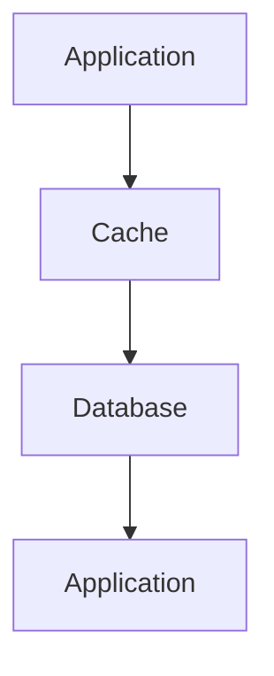

we can do this:

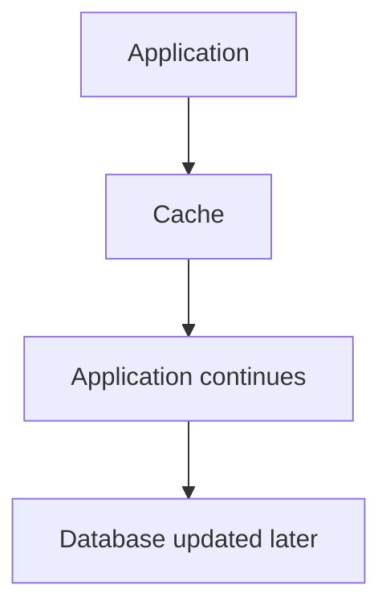

The write is acknowledged as soon as it reaches the cache.

The database update happens asynchronously.

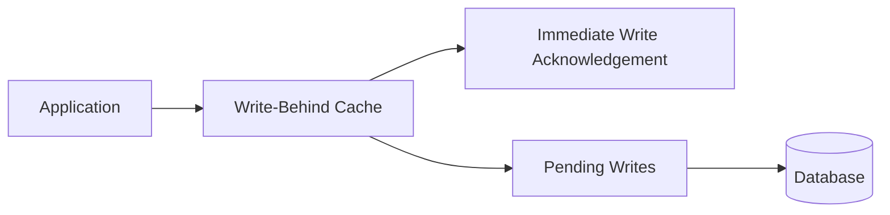

This changes one critical property of the system.

The database is no longer on the synchronous write path.

And that can have a massive impact on throughput.

---

### The Basic Write-Behind Flow

Suppose a customer changes their preference.

The application sends:

```text
theme = dark
```

The cache accepts it immediately.

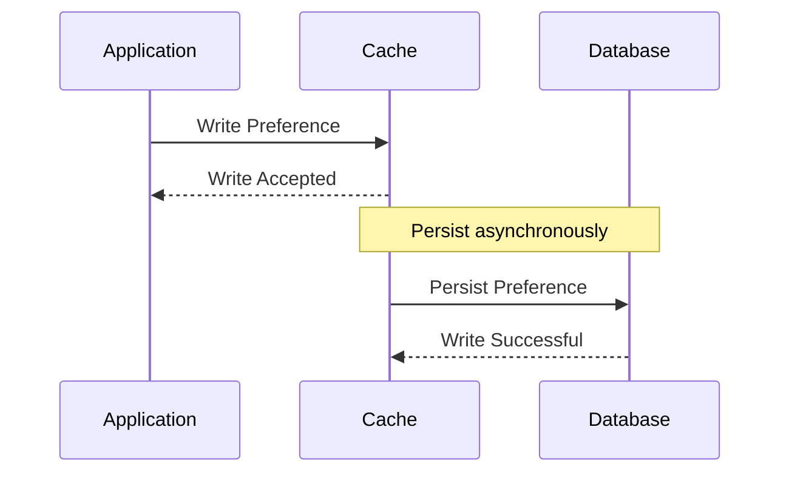

From the application's perspective, the operation completed before the database write finished.

That's the key difference from Write-Through.

---

### Why Is This Faster?

Imagine 10,000 updates arriving within a short period.

With Write-Through, each update may require a database round trip.

With Write-Behind, the cache can accept the updates rapidly and persist them later.

More importantly, the cache can potentially batch multiple updates together.

Instead of:

```text
Write 1 → Database
Write 2 → Database
Write 3 → Database
Write 4 → Database
...
```

the persistence layer might process:

```text
Write 1
Write 2
Write 3
Write 4
       ↓
   One Batch
       ↓
   Database
```

This can significantly reduce network overhead and database transaction costs.

---

### Batching Writes

Suppose 1,000 individual updates arrive.

The cache could persist them individually:

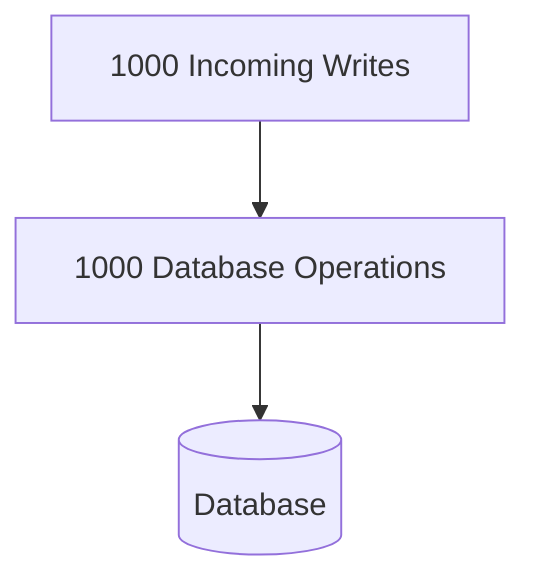

Or it could accumulate them briefly and send them as batches:

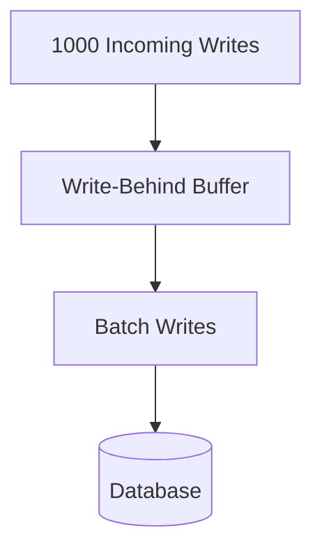

The second approach can dramatically reduce the number of database operations.

This is one of the biggest performance advantages of asynchronous write systems.

The database doesn't necessarily have to process every application operation independently.

---

### The Trade-Off We Just Introduced

There is no free performance improvement.

We removed the database from the critical path.

That means there is now a period where:

```text
Cache → New Value

Database → Old Value
```

The two stores are temporarily inconsistent.

Suppose a user changes their profile name from:

**Rohan**

to:

**Rohan Kumar**

The cache may immediately contain:

**Rohan Kumar**

while the database still contains:

**Rohan**

until the asynchronous persistence completes.

This is eventual consistency.

The system prioritizes fast writes and high throughput over immediate database consistency.

---

### Design Challenge

Consider two systems.

**System A**

A social media "like" counter.

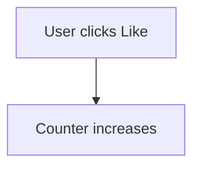

A small delay before the database reflects the new count may be acceptable.

**System B**

A bank account balance.

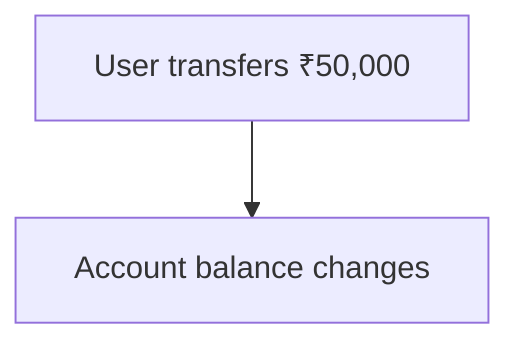

Can we safely acknowledge the transaction before the durable financial record has been persisted?

Obviously, the answer is much more complicated.

This illustrates the central question behind Write-Behind:

> Can the business tolerate a period where the cache contains information that hasn't been durably persisted yet?

If the answer is no, Write-Behind is probably the wrong pattern.

---

### The Biggest Risk: Cache Failure

Now we reach the most important problem.

Suppose the cache accepts:

```text
Order 1001 → Confirmed
Order 1002 → Confirmed
Order 1003 → Confirmed
```

But those writes haven't reached the database yet.

Then the cache crashes.

What happens to the pending data?

If those writes existed only in volatile memory, they may simply disappear.


This is the fundamental risk of Write-Behind caching.

With Write-Through, a successful operation generally waits for database persistence.

With Write-Behind, a successful operation may mean:

> "The cache accepted your data."

That is a much weaker durability guarantee.

---

### Durability Becomes a First-Class Concern

Once writes can exist temporarily only in the cache, we need to ask how those writes survive failures.

Possible mechanisms include:

persistent cache storage,
replication,
append-only logs,
durable queues,
write-ahead logs,
periodic snapshots,
acknowledgements only after durable buffering.

The exact implementation depends on the system.

The architectural principle is more important:

If the cache is temporarily holding the only copy of a write, that cache is now part of your durability boundary.

That makes cache reliability extremely important.

---

### A Durable Write-Behind Architecture

One common approach is to introduce a durable intermediate log or queue.

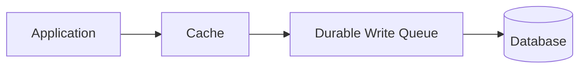

The cache can respond quickly while the durable queue protects pending writes from a cache restart.

The database can then consume the queued operations asynchronously.

This architecture starts looking less like a traditional cache and more like an asynchronous data pipeline.

That's an important observation.

As the requirements for Write-Behind become stronger, the supporting architecture becomes more sophisticated.

---

### What If the Same Key Is Updated Multiple Times?

Suppose the following writes arrive:

```text
Product 101 → ₹999
Product 101 → ₹899
Product 101 → ₹849
Product 101 → ₹799
```

Do we really need to persist all four intermediate states?

Maybe not.

If only the final state matters, the system could potentially collapse the updates:

```text
Product 101 → ₹799
```

and persist only the latest value.

This is another major advantage of asynchronous buffering.

The persistence layer can sometimes coalesce writes.

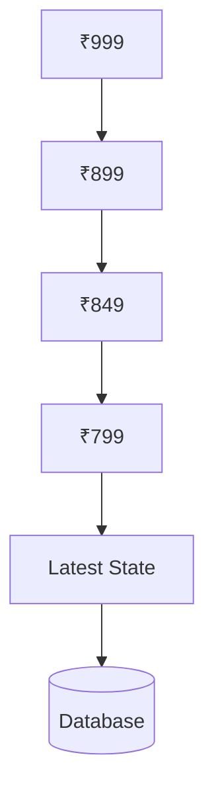

This can dramatically reduce database work for rapidly changing values.

However, it is safe only when intermediate states don't matter.

If every state represents a meaningful event, collapsing them would lose information.

---

### State vs Events

This distinction is extremely important.

Suppose you're storing:

```text
User online = true
```

then:

```text
User online = false
```

If only the latest state matters, intermediate writes can potentially be collapsed.

But consider:

```text
Payment initiated
Payment authorized
Payment captured
Payment refunded
```

These are not simply different versions of the same state.

They represent a sequence of business events.

You generally cannot safely replace them with only:

```text
Payment refunded
```

because the intermediate events may be required for auditing, analytics, reconciliation, or business logic.

Write-Behind works best when the system can safely treat writes as state updates rather than irreplaceable events.

---

### Ordering Matters

Asynchronous persistence also introduces ordering problems.

Suppose:

```text
Update A → ₹899
Update B → ₹799
```

If B reaches the database first and A arrives afterward, the database could incorrectly end up with:

```text
₹899
```

even though ₹799 was the newer value.

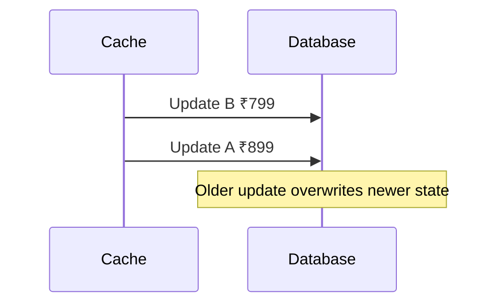

To prevent this, systems may use:

- sequence numbers,
- timestamps,
- versions,
- per-key ordering,
- optimistic concurrency,
- partitioned queues.

Again, asynchronous processing doesn't remove distributed-systems problems.

It makes them more visible.

---

### Backpressure

What happens if the cache receives writes faster than the database can persist them?

Suppose:

```text
Incoming writes → 200,000/sec
Database capacity → 100,000/sec
```

The pending-write queue will continue growing.

Eventually, the buffer itself can run out of memory or storage.

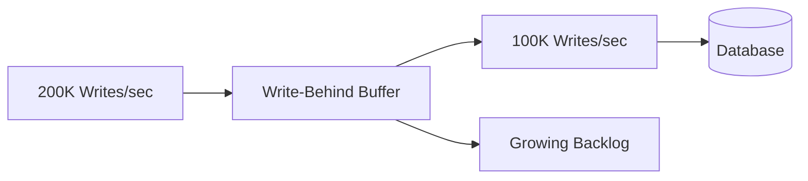

This is called backpressure.

A production system needs to know what happens when the downstream system cannot keep up.

Possible responses include:

- increasing persistence capacity,
- batching,
- throttling producers,
- scaling consumers,
- temporarily rejecting writes,
- dropping data when the business allows it.

The worst possible strategy is pretending the system has unlimited capacity.

---

### Monitoring Write-Behind Systems

A synchronous write system can often tell you immediately whether the database accepted the operation.

Write-Behind requires additional observability.

Useful metrics include:

- Pending write count
- Queue depth
- Oldest pending write age
- Write persistence latency
- Persistence failure rate
- Retry count
- Cache memory usage
- Dropped writes
- Database throughput
- Consumer lag

One metric is particularly important:

**How far behind is the database?**

If the cache accepts a write immediately but the database receives it 30 seconds later, the system may technically be functioning while still violating business expectations.

Latency between:

**Write Accepted**

and

**Write Persisted**

should therefore be treated as a first-class metric.

---

### Write-Through vs Write-Behind

The difference can now be summarized clearly.

|                           | Write-Through          | Write-Behind                      |
| ------------------------- | ---------------------- | --------------------------------- |
| Database write            | Synchronous            | Asynchronous                      |
| Application latency       | Higher                 | Lower                             |
| Database on critical path | Yes                    | No                                |
| Read-after-write          | Stronger               | Potentially eventually consistent |
| Write throughput          | Limited by persistence | Can be much higher                |
| Data-loss risk            | Lower                  | Higher                            |
| Implementation complexity | Moderate               | High                              |
| Batching opportunities    | Limited                | Strong                            |

Write-Through favors consistency and durability.

Write-Behind favors write throughput and latency.

Neither is universally better.

They solve different problems.

---

### Write-Behind vs Message Queues

At this point, someone might ask:

> "Why use a cache at all? Why not just put the writes into Kafka or another message queue?"

That's a very reasonable question.

In many architectures, that's exactly what you should do.

A durable message broker is designed specifically for asynchronous data pipelines and durable event processing.

A cache is primarily designed for fast data access.

Once Write-Behind becomes heavily dependent on durable queues, ordering, retries, consumer scaling, and persistence guarantees, you're effectively building an asynchronous messaging architecture around the cache.

That's not necessarily wrong.

But it should make you question whether the cache is still the right abstraction.

---

### When Write-Behind Makes Sense

Write-Behind can be a strong fit when:
- Write throughput is extremely high.
- The application can tolerate eventual consistency.
- Intermediate database states aren't important.
- Writes can be batched or coalesced.
- Temporary persistence delays are acceptable.
- The system has a reliable recovery mechanism.

Good candidates can include:
- counters,
- analytics aggregates,
- user activity,
- high-volume telemetry,
- metrics,
- non-critical preference updates,
- workloads where only the latest state matters.

The exact suitability depends on the durability and consistency requirements.

---

### When You Should Avoid It

Write-Behind is usually a poor choice when every successful write must be immediately durable.

Examples include many:
- financial transactions,
- critical inventory reservations,
- security permissions,
- compliance records,
- audit trails,
- irreversible business operations.

In these systems, losing an acknowledged write can be far more expensive than accepting additional write latency.

The performance improvement isn't worth weakening the correctness guarantees.

---

### The Three Caching Patterns So Far

We've now seen three different ways to handle writes.

**Cache-Aside**

The application manages the database and cache.

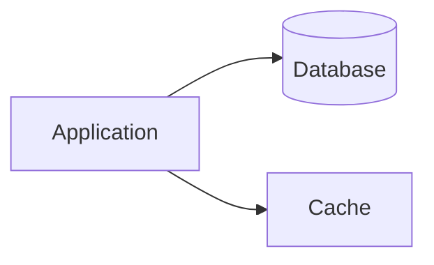

**Write-Through**

The cache receives the write and synchronously persists it.

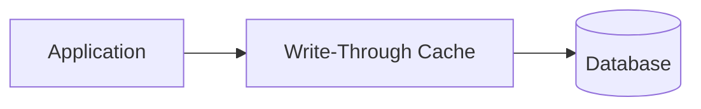

**Write-Behind**

The cache accepts the write and persistence happens asynchronously.

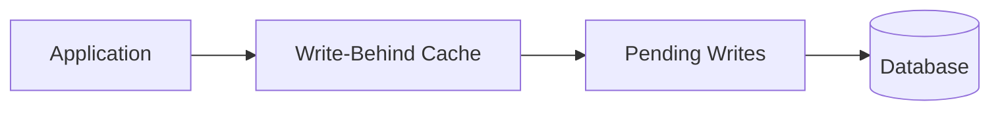

Notice the progression.

As we move from Cache-Aside to Write-Through to Write-Behind, more responsibility moves into the caching layer.

At the same time, we increasingly trade immediate consistency for performance.

---

### The Real Engineering Decision

The temptation with Write-Behind is to focus on the impressive numbers.

Millions of writes per second.

Lower latency.

Batched database operations.

Reduced database pressure.

But those benefits come from making a deliberate trade:

> The system is willing to temporarily treat the cache as the latest state even though the database hasn't caught up yet.

That's not a minor implementation detail.

It's an architectural decision.

Before using Write-Behind, ask:

What happens if we lose the cache right now?

If the answer is:

> "We lose data."

then the next question should be:

Can the business tolerate that loss?

If the answer is no, you need stronger durability guarantees before using this pattern.

---

### Key Takeaways

Write-Behind, or Write-Back caching, removes the database from the synchronous write path.

The application writes to the cache and receives an immediate response. The cache then persists the change asynchronously, often allowing writes to be batched, reordered safely, or coalesced when only the latest state matters.

This can dramatically improve write throughput and reduce database pressure.

But the performance comes from accepting a weaker guarantee.

For some period of time, the cache may contain data that the database does not yet have.

That makes eventual consistency, ordering, backpressure, monitoring, and durability critical parts of the design.

The most important question isn't:

> "How much faster is Write-Behind?"

It's:

> "What are we willing to risk in exchange for that speed?"

If losing an acknowledged write is unacceptable, Write-Behind may be the wrong pattern.

If the workload can tolerate delayed persistence and the system can protect pending writes with durable infrastructure, it can be an extremely powerful tool for high-throughput systems.

---

### In the Next Chapter

We've now explored the major write strategies:

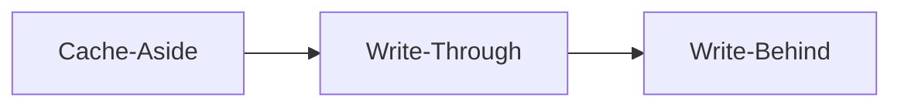

But there's still another problem.

Even if we have the perfect read and write strategy, our cache has finite memory.

What happens when the cache fills up?

Which data should stay?

Which data should be removed?

And why might Least Recently Used, Least Frequently Used, or TTL-based eviction produce completely different results for the same workload?

In the next chapter, we'll explore Cache Eviction Policies and understand how a cache decides what to forget when it runs out of space.