## Write-Through Cache: Should Every Write Go Through the Cache?

**Previously...**

In the previous chapter, we moved from Cache-Aside to Read-Through caching.

With Cache-Aside, the application decides when to read from the cache and when to fall back to the database. With Read-Through, that responsibility moves into the cache layer, allowing the application to simply ask for data without knowing how a cache miss is handled.

But both patterns have mostly focused on one side of the system:

**Reading data.**

Eventually, every production system reaches the other side of the problem.

Data changes.

A customer changes their profile. A seller updates a product price. An administrator changes application configuration. An order moves from `Pending` to `Confirmed`.

Now we have a question that is much harder than simply reading from a cache:

> **When the data changes, which copy should be updated first?**

Because once we have a cache, the same piece of information can exist in two places.

```text
Database
Product 101 → ₹999

Cache
Product 101 → ₹999
```

What happens when the price becomes ₹899?

That is where the Write-Through Cache Pattern enters the picture.

---

### What You'll Learn

By the end of this blog, you'll understand:

- Why writing to a cache creates consistency challenges.
- How the Write-Through pattern changes the write path.
- Why the cache becomes responsible for persisting data.
- How Write-Through differs from Cache-Aside and Read-Through.
- What happens when the database or cache fails during a write.
- Why Write-Through can simplify reads but increase write latency.
- When this pattern makes sense and when it doesn't.

---

### The Problem With Two Copies of Data

Let's return to our e-commerce platform.

Suppose a product currently costs:

```text
₹999
```

The database contains:

```text
Product 101 → ₹999
```

The cache contains:

```text
Product 101 → ₹999
```

Everything is consistent.

Now a seller changes the price:

```text
₹999 → ₹899
```

The application updates the database.

But what happens to the cache?

If the cache isn't updated or invalidated correctly, we can end up with:

```text
Database → ₹899

Cache → ₹999
```

The next customer might receive the wrong price.

This is the fundamental problem with caching mutable data:

**Performance introduced a second copy, and the second copy introduced a consistency problem.**

---

### The Traditional Approach

With Cache-Aside, the application typically owns the write logic as well.

One possible strategy is:

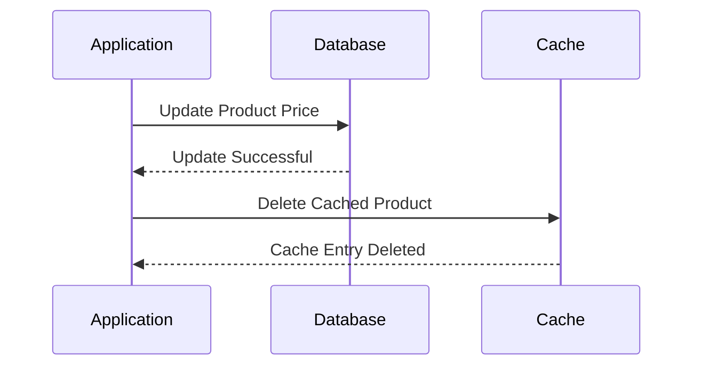

The next read then repopulates the cache.

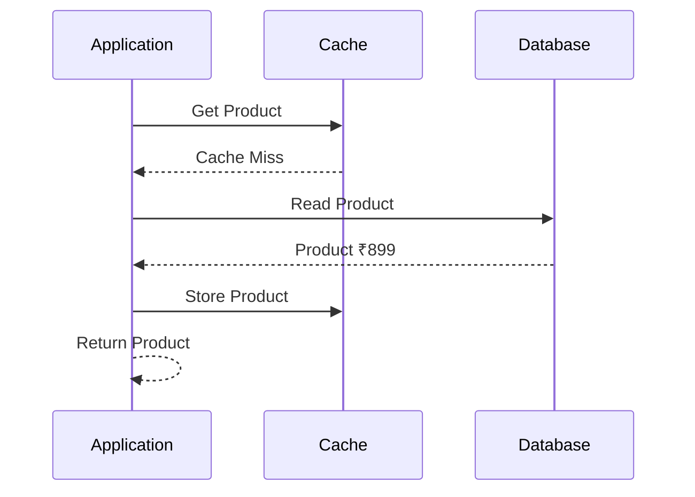

This works.

But notice how many responsibilities the application now has.

It needs to know:

- when to update the database,
- when to invalidate the cache,
- what cache key to use,
- what happens if invalidation fails,
- how stale entries should be handled.

The more services you have, the more places this logic appears.

---

### What If the Cache Owned the Write?

Instead of asking the application to update both systems, we can change the responsibility.

The application sends the updated value to the cache.

The cache then writes that value to the database.

That is the basic idea behind **Write-Through caching**.

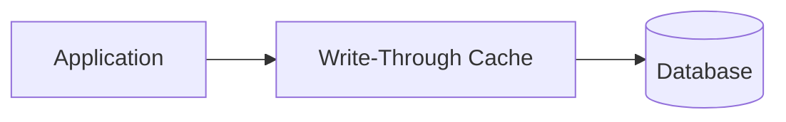

The application doesn't directly perform the database write.

The cache becomes the entry point for both reading and writing cached data.

This gives us a very different architecture.

---

### The Basic Write-Through Flow

Suppose the application wants to change Product 101 from ₹999 to ₹899.

The request looks like this:

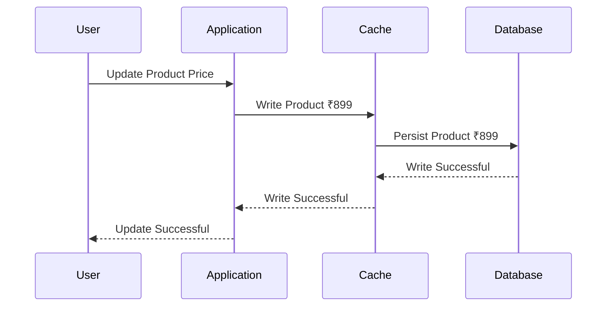

The important detail is the direction of the write.

The application writes to the cache.

The cache writes to the database.

The cache is now responsible for making sure the persistent store receives the update.

---

### Why Do This?

At first, this might seem like an unnecessary extra step.

Why not simply:

```text
Application → Database
```

The answer becomes clearer when the application is both reading and writing the same data frequently.

With Write-Through, once the write succeeds, the cache already contains the latest value.

A subsequent read doesn't need to wait for the database.

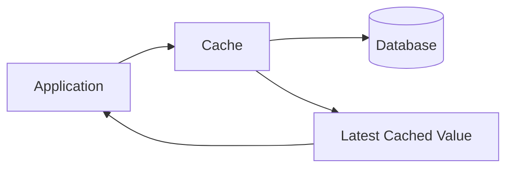

This can make the read path very efficient because the cache doesn't need to be invalidated and repopulated after every successful write.

---

### Compare the Two Approaches

With Cache-Aside, the typical flow looks like:

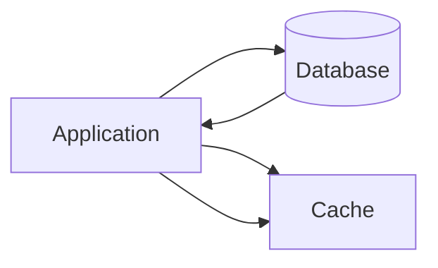

The application coordinates the two systems.

With Write-Through:


The cache coordinates persistence.

That difference may look small on a diagram, but it represents a significant architectural change.

**The ownership of the write path has moved.**

---

### The Cache Is No Longer Just a Cache

This is the first important trade-off.

A traditional cache can be relatively simple:

```text
Key → Value
```

A Write-Through cache needs to understand much more.

It needs to know how to persist data.

It needs to handle database failures.

It needs to decide what happens when persistence succeeds but cache storage fails.

It may need retry logic.

It needs monitoring.

It may need transaction or consistency guarantees.

The cache has effectively become part of the data-access architecture.

That can be extremely useful.

But it also means the cache is now a much more critical component.

---

### Design Challenge

Imagine you're building an application where:

- Product information is read millions of times per day.
- Product prices change occasionally.
- Product descriptions change rarely.
- Inventory changes constantly.

Would you want every piece of data to use Write-Through?

Not necessarily.

The pattern may be valuable for frequently accessed data where keeping the cache warm after a write is useful.

But applying it indiscriminately can add unnecessary write overhead and complexity.

This is an important lesson with caching patterns:

> **A pattern should follow the access pattern and consistency requirements of the data, not the other way around.**

---

### The Hidden Cost: Write Latency

With a direct database write, the application might perform:

```text
Application
    ↓
Database
```

With Write-Through:

```text
Application
    ↓
Cache
    ↓
Database
```

There is now another component involved in the write path.

That can add latency.

More importantly, the application cannot necessarily consider the operation complete until the database persistence succeeds.

Write-Through therefore trades some write-path complexity and latency for a simpler, warmer read path.

That trade-off can make sense for read-heavy workloads.

---

### Read-Heavy Systems

Consider a product catalog.

Suppose:

```text
Reads  → 1,000,000/min
Writes → 500/min
```

Most operations are reads.

If every successful write also updates the cache, future reads can immediately use the latest cached value.

The relatively small write overhead may be worthwhile because the cache absorbs a massive amount of read traffic.

This is where Write-Through becomes particularly interesting.

---

### But What About Write-Heavy Systems?

Now imagine a telemetry system:

```text
Reads  → 100,000/min
Writes → 10,000,000/min
```

Every write now has to pass through the cache and eventually reach the database.

The cache may become part of the critical path for an enormous number of writes.

In such systems, another pattern may make more sense.

For example, **Write-Behind caching** can acknowledge writes to the cache and persist them asynchronously.

That can dramatically improve write throughput, but it introduces a completely different set of durability and consistency trade-offs.

We'll explore that in the next chapter.

---

### Where Write-Through Fits

At this point, we can see the progression:

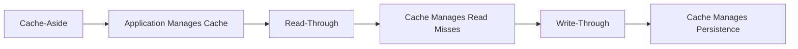

Each pattern moves more responsibility into the caching layer.

That can simplify application code.

But it also makes the cache increasingly important to the overall architecture.

---

### Write-Through Cache

The difficult part of Write-Through caching isn't the normal write. The normal path is straightforward: the application sends the new value to the cache, the cache persists it to the database, and the operation succeeds.

Production systems are defined by what happens when that normal path breaks.

What if the database is slow? What if the cache crashes after the database write succeeds? What if two users update the same record at nearly the same time? And what happens when the cache reaches its memory limit?

These are the decisions that determine whether Write-Through is actually useful in a production architecture.

---

### What Does "Successful Write" Mean?

Let's start with the most important question.

Suppose the application sends:

```text
Product 101 → ₹899
```

to the cache.

The cache accepts the value but hasn't successfully persisted it to the database yet.

Should the application receive:

```text
200 OK
```

Probably not.

If the application tells the user that the price update succeeded while the database still contains ₹999, we now have a system that reports success for data that isn't actually durable.

A safer Write-Through implementation generally considers the write complete only after the underlying persistent store has successfully accepted it.

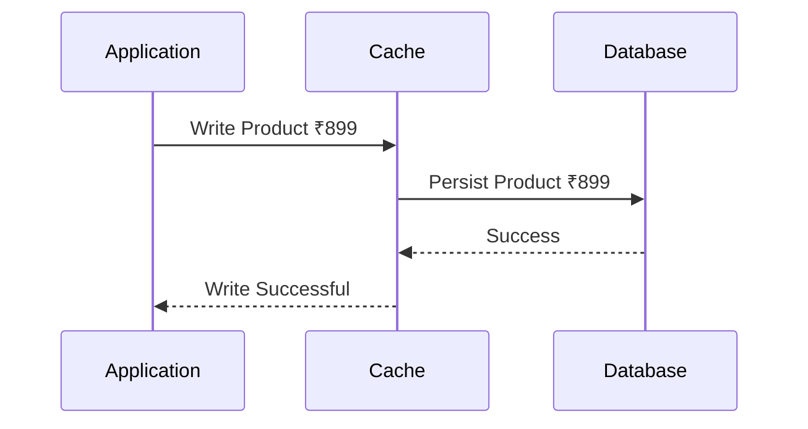

The cache can then contain the latest value immediately.

This gives us an important property:

> A successful write leaves both the cache and persistent store representing the new state.

The exact consistency guarantees depend on the implementation, but this is the fundamental goal.

---

### What If the Database Is Down?

Now imagine the database becomes unavailable.

The application attempts to update a product.

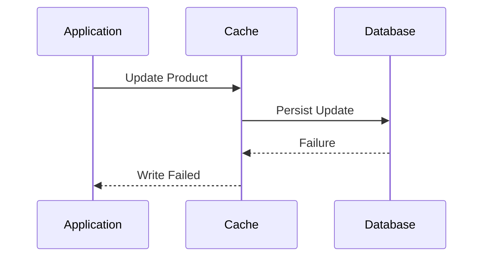

The cache should not simply pretend the write succeeded.

Otherwise, the application may continue operating with data that exists only in the cache and has not been durably persisted.

Depending on the implementation, the cache might:

- reject the write,
- retry the database operation,
- temporarily queue the operation,
- or use another recovery mechanism.

But each choice changes the durability guarantees.

This is why Write-Through is not simply a performance optimization. It becomes part of the application's data consistency and durability strategy.

---

### What If the Database Succeeds but the Cache Fails?

Now consider the reverse.

The database successfully stores the new value.

Immediately afterward, the cache crashes before the updated value is available.

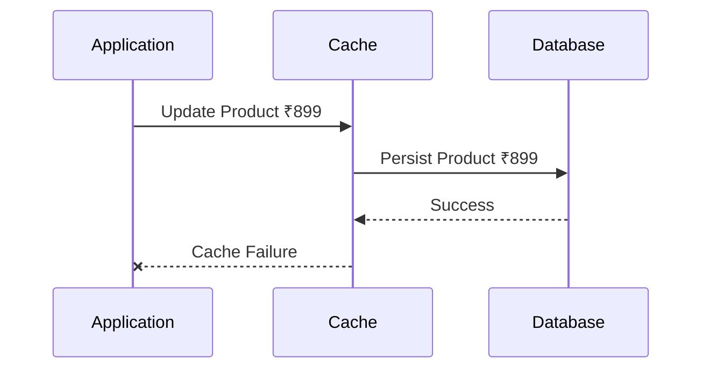

The database contains:

```text
₹899
```

The cache may still contain:

```text
₹999
```

This creates a temporary consistency problem.

The recovery strategy depends on the cache implementation.

The system might invalidate the old entry, repopulate it from the database, or allow the cache entry to expire naturally.

The important point is that Write-Through doesn't magically create a distributed transaction between cache and database.

The two systems can still fail independently.

---

### Write Ordering Matters

Consider these two sequences.

**Database First**

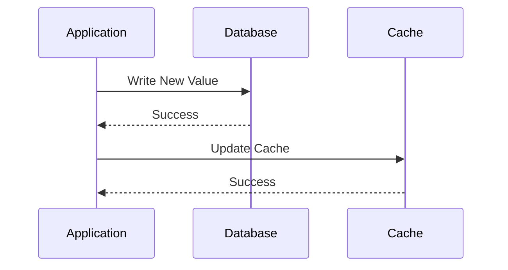

**Cache First**

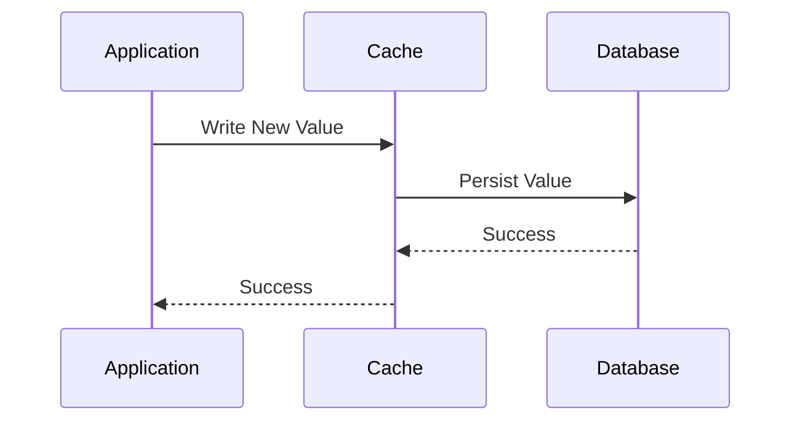

The second flow represents the typical Write-Through idea: the cache is the write entry point and is responsible for persistence.

The first flow is closer to a Cache-Aside write strategy where the application coordinates the database and cache itself.

The distinction is important because it determines who owns the consistency workflow.

---

### What Happens With Concurrent Writes?

Now consider two users updating the same product.

User A changes:

```text
₹999 → ₹899
```

At almost the same time, User B changes:

```text
₹999 → ₹849
```

If both operations are allowed to execute without coordination, the final state depends on the ordering of the writes.

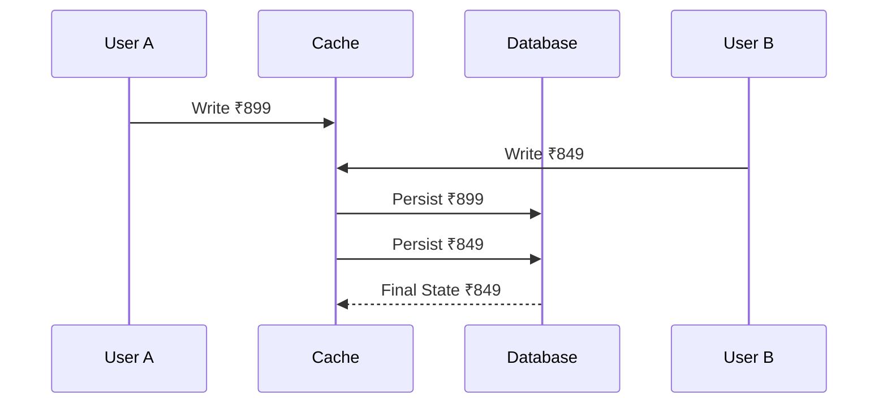

This isn't necessarily a bug.

It may be exactly what the application expects if the system uses last-write-wins semantics.

But some systems need stronger guarantees.

For example, inventory updates cannot simply assume that whichever request arrives last should win.

You may need:

- optimistic locking,
- version numbers,
- compare-and-set operations,
- database transactions,
- or another concurrency-control mechanism.

Caching doesn't remove these database-level concerns.

---

### Versioning Can Help

One way to prevent stale updates from overwriting newer ones is to attach a version to the data.

For example:

```text
Product 101
Price: ₹899
Version: 42
```

Another update expects version `42`.

If the database has already moved to version `43`, the update can be rejected rather than silently overwriting newer data.

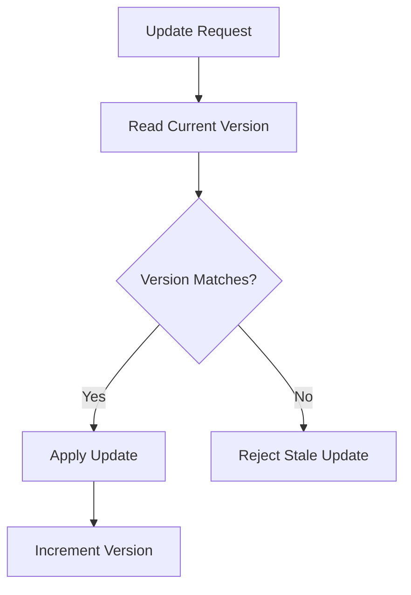

This approach becomes particularly valuable when multiple clients can modify the same data concurrently.

---

### Write-Through and TTL

At this point, you might wonder:

> If every write updates the cache, why do we still need TTL?

Because cached data can become stale for reasons other than the application's normal write path.

For example:

- Another service may update the database.
- An administrator may modify data directly.
- A background process may change a record.
- A migration may update many rows.
- An external system may be the actual source of truth.

TTL provides a safety boundary.

Even if something goes wrong with invalidation or synchronization, the cached value won't necessarily remain forever.

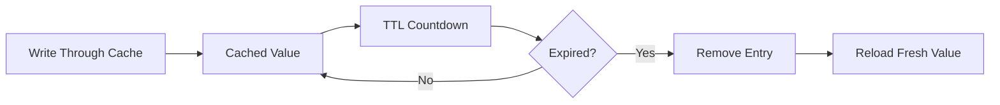

Again, TTL is not a replacement for correct consistency logic.

It's a safety mechanism.

---

### Write-Through Doesn't Mean Every Write Must Be Cached Forever

Suppose the cache has limited memory.

A product may be updated once but never requested again.

Keeping that product in the cache indefinitely wastes memory.

This is where eviction policies become important.

The cache may remove entries based on:

- TTL
- Least Recently Used
- Least Frequently Used
- memory pressure

The next read simply loads the current value again.

Write-Through therefore doesn't eliminate cache eviction. It only changes how data enters the cache during writes.

---

### The Biggest Advantage: A Warm Cache

One of the strongest reasons to use Write-Through is that successful writes can keep the cache populated.

Consider a newly created product.

Without Write-Through:

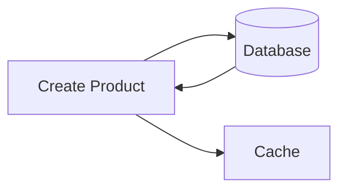

The application needs to explicitly decide whether and how to populate the cache.

With Write-Through:

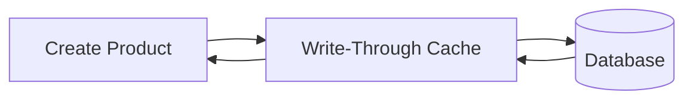

The newly written value is already available through the cache.

If the next operation is a read, it can potentially be served without another database lookup.

This is particularly useful in workloads where writes are frequently followed by reads.

---

### But Write-Through Can Increase Write Latency

The trade-off is straightforward.

A write now depends on the cache and the persistent store.

If the database takes:

```text
20 ms
```

and the cache adds:

```text
2 ms
```

the additional latency may be negligible.

But if the cache layer introduces significant network overhead or the database is already slow, the additional hop becomes more noticeable.

The architecture therefore needs to balance:

```text
Read Performance
        vs
Write Latency
        vs
Consistency
```

There is no universally optimal configuration.

---

### Write-Through vs Cache-Aside

Now let's put the two patterns side by side.

|                        | Cache-Aside                  | Write-Through    |
| ---------------------- | ---------------------------- | ---------------- |
| Read miss              | Application handles it       | Cache handles it |
| Write entry point      | Usually application/database | Cache            |
| Cache population       | Application                  | Cache            |
| Application complexity | Higher                       | Lower            |
| Cache responsibility   | Lower                        | Higher           |
| Read performance       | High                         | High             |
| Write path             | Simpler                      | More involved    |
| Flexibility            | High                         | More centralized |

The most important difference isn't performance.

It's responsibility.

With Cache-Aside, the application owns the relationship between cache and database.

With Write-Through, the cache becomes responsible for coordinating persistence.

---

### Write-Through vs Read-Through

These two patterns are also easy to confuse.

Read-Through answers:

> "What should happen when data isn't in the cache?"

Write-Through answers:

> "What should happen when data changes?"

They can be used independently.

But they can also be combined.

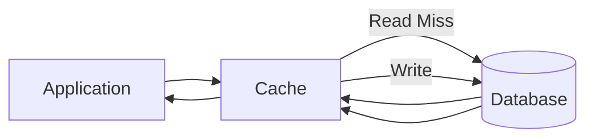

Now the cache owns both:
- loading missing data,
- persisting updated data.

The application can interact with one data-access layer without directly managing the database.

This can create a very clean architecture when the caching layer is mature enough to support it.

---

### When Write-Through Makes Sense

Write-Through is particularly attractive when:
- Data is read frequently after being written.
- Keeping the cache warm is valuable.
- The application benefits from centralized cache policies.
- Cache and database updates need to follow a consistent workflow.
- The caching infrastructure is reliable enough to become part of the critical write path.

A product catalog is a good example.

A product may be updated occasionally but read thousands or millions of times.

Keeping the latest value in the cache can provide a significant benefit.

---

### When It May Not Be the Right Choice

Write-Through can be a poor fit when the system is heavily write-oriented.

Imagine a telemetry platform receiving millions of events per minute.

If every write must pass through a caching layer before reaching persistent storage, the cache may become unnecessary overhead.

Likewise, if cached data has little read value, there may be no reason to populate it on every write.

In such systems, direct writes, asynchronous pipelines, batching, or Write-Behind caching may be more appropriate.

The correct question isn't:

> "Is Write-Through faster?"

It's:

> "Does keeping the cache synchronized on every write provide enough value to justify the additional write-path complexity?"

---

### Common Mistakes

Treating the Cache as the Database

A cache is generally not a replacement for durable storage.

If the database is your source of truth, don't design the system as though losing the cache means losing the data.

---

**Ignoring Cache Failures**

If the cache sits directly in the write path, its availability becomes critical.

You need clear behavior for:
- timeouts,
- connection failures,
- database failures,
- retries,
- partial failures.

---

**Assuming Consistency Is Automatic**

Write-Through improves the synchronization workflow, but distributed failures can still produce temporary inconsistencies.

You still need to reason about concurrency, ordering, invalidation, and recovery.

---

**Using It for Everything**

Not every piece of data needs to be cached.

If an object is rarely read, putting every write into the cache may simply increase resource usage without providing meaningful benefit.

---

**A Practical Decision**

Suppose you're designing an e-commerce product system.

You have:

```text
Product Description
Product Price
Inventory
Customer Reviews
```

You might choose different strategies for each.

Product descriptions change rarely and are read frequently, making them excellent cache candidates.

Prices change more often but may still benefit from caching depending on business requirements.

Inventory changes rapidly and may require much stronger freshness guarantees.

Reviews can often tolerate some staleness.

The important lesson is that caching strategy belongs to the data, not just the application.

A single service can legitimately use different caching strategies for different datasets.

---

### Key Takeaways

Write-Through caching moves the write responsibility into the cache layer. Instead of the application updating the database and separately managing the cache, the application writes through the cache, which persists the change to the underlying data store.

The biggest benefit is a warm cache with a predictable write path. After a successful write, the latest value is already available for subsequent reads.

The cost is equally important. The cache becomes part of the critical write path, which increases its operational importance and can add write latency.

Write-Through is therefore most valuable when the system is read-heavy, frequently accesses recently written data, and benefits from centralized cache management.

The broader lesson is more important than the pattern itself:

> Caching is not just about making reads faster. It's about deciding where the system should keep copies of data and how those copies should behave when the underlying state changes.

---

### In the Next Chapter

Write-Through waits for the database before considering a write complete.

That's safe, but it means every write still depends on the database.

Now imagine a system receiving millions of writes per second.

What if the cache could acknowledge the write immediately and persist it to the database later?

That could dramatically improve write throughput.

But it also means accepting a much more dangerous trade-off:

What happens if the cache fails before those writes reach durable storage?

In the next chapter, we'll explore Write-Behind (Write-Back) Cache, where performance takes priority and persistence happens asynchronously.
